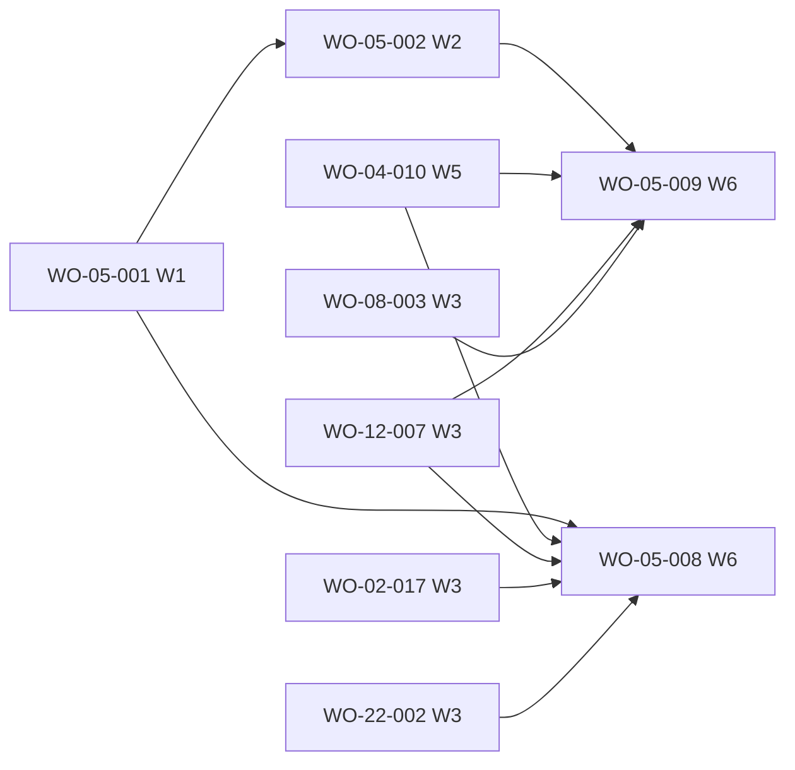

# FRD-05 — Work orders (live view) · feature blueprint (v2 «Órbita»)

> **Source-of-truth hierarchy:** `FRD > FDD > design-tokens > blueprint > work order`.
> Per-FRD blueprint (DR-049). It describes how the work-order views are built on top of the platform
> ([`../../product/architecture.md`](../../product/architecture.md): §6 read interfaces, §7 cross-cutting,
> Route map) and does not restate it. Binding visual spec: [`fdd.md`](fdd.md) + [`mocks/work-orders.html`](mocks/work-orders.html)
> (the frozen Órbita prototype, ADR-0012). Cross-FRD plan: `.pandacorp/run/architecture/wo-map.md` (§0 global rules,
> §2 FRD-05, §3.3 test-side supersession, §6.C removals).

## Purpose

FRD-05 is the read-only work-order section of a project. In v2 it lives inside the workspace's **Observabilidad**
tab (FRD-04 owns the frame and the tab bar; there is no separate Work orders tab) as two of its three views,
**Por FRD** (default) and **Tablero**, plus the **work-order detail** (Resumen and Documento completo). The third
view, **Dependencias**, is FRD-12's `DependencyMap`, which this feature mounts. Everything reads the work-order
frontmatter through `src/lib/work-orders/` (one source, DR-092/DR-115) and refreshes live from the SSE transport.

v1 code that v2 rewrites or removes (map §6.C items 6 and 8): the old Work orders tab body (`TabWorkOrders`, the
five-column pill-filtered board, `WoFrdFilteredBoard`, the pill filters), the Línea de tiempo
(`_observability/TimelineView`, `ObservabilidadTab`), the force-layout `WoDag` (its zoom controls, `useDagZoom`,
fullscreen, «saltar al primer error», follow mode). Removed in WO-05-008, never kept behind a flag (PRD A-2).

## Components & Interfaces

| ID | Kind | Name · location | Responsibility | Traces |
|---|---|---|---|---|
| CMP-05-observability-panel | RSC | `ObservabilidadPanel` · `src/app/projects/[slug]/_panels/ObservabilidadPanel.tsx` (stub created by WO-04-010, rewritten here) | Loads the project's work orders, FRD index and drift once per request; renders the toolbar and the selected view from the URL (`view`, `frd`, `state`); mounts `DependencyMap` for `view=deps` and `WoDetail` for `wo=`; mounts the live refresher once; the empty-project state. | REQ-05-005, REQ-05-006, REQ-05-008 |
| CMP-05-view-toolbar | client island | `WoViews` · `_components/wo-views/` | `Segmented` Por FRD · Tablero · Dependencias (URL `view`), the «Filtrar por FRD» `SelectField` (`WoFrdFilter`, restyled in place in `_components/wo-frd-filter/`, URL `frd`) and the muted work-order count. | REQ-05-003, REQ-05-008 |
| CMP-05-state-tiles | client island | the shared core `StateTile` (`src/components/core/StateTile/`, created by WO-22-002 in W3 for the Backlog tiles; components.md's route path relocated, name unchanged) composed by the strip `WoStateFilter`, restyled in place in `_components/wo-state-filter/` | Four tiles (a fifth «Bloqueado» only while an order failed) with dot, display count and bar; `aria-pressed` toggles in the URL `state`, combinable with each other and with the FRD select. | REQ-05-007, REQ-05-002 |
| CMP-05-frd-rows | RSC + client toggle | `FrdRow`, `WorkOrderRow`, `WoByFrd` · `_components/wo-views/` (relocated from components.md's `_components/wo/`, names unchanged) | Por FRD: native `details` per FRD (code, title, `StackBar` with its text alternative, «n/m», «%»), every group collapsed at rest, one «Expandir todo» / «Colapsar todo» toggle, groups open while filtering; rows with id, title, state chip, dependency count in a fixed-width column; failed row coral with alert icon; mounts the FRD-12 drift badge and note. | REQ-05-002, REQ-05-003, REQ-05-005, REQ-05-008 |
| CMP-05-board | RSC + client «Mostrar más» | `WorkOrderBoard`, `WorkOrderColumn`, `WorkOrderCard` · `_components/wo-board/` (restyled in place; components.md places the card at `_components/wo/`, relocated here) | Tablero: columns Planificado · En curso · En revisión · Verificado, plus «Bloqueado» after Verificado only while an order failed (danger header with alert icon); equal-width columns with horizontal scroll; at most 8 cards (4 below 760 px) then `MoreBar` «Mostrar N más» / «Mostrar menos»; an empty column is one line; card = id, title, FRD code and dependency count; the `fail` variant (coral fill and border, alert icon, danger title, blocked reason) is the same card. | REQ-05-001, REQ-05-002, REQ-05-003, REQ-05-008 |
| CMP-05-empty | RSC | `WorkOrderEmpty` · `_components/wo-empty/` (restyled) | The dashed `EmptyState` sentence and the `/pandacorp:architecture` `CommandBox` when the project has no work orders. | REQ-05-005 (edge) |
| CMP-05-live-refresh | client | `WoLiveRefresh` · relocated to `src/app/projects/[slug]/_observability/WoLiveRefresh/` | One subscription to `useLiveSnapshot` (the SSE transport); throttled `router.refresh()` on a genuinely fresher event (`isNewerTimestamp`) OR a moved `stateVersion` (`lib/status/state-version-moved.ts`), so a backward transition (gate reopen) is visible. Mounted once by the panel; covers the three views and the open detail. | REQ-05-006, FRD real-time bullet |
| CMP-05-detail | RSC + client tabs | `WoDetail` (self-loading seam) and `WorkOrderDetail` (presentational, restyled in place) · `_components/wo-detail/`; `WoSteps`, `CriterionList`, `DependencyButton` relocated into the same folder | Crumbs, tinted hero (id chip, FRD chip, title, «Volver» keeping `view`/`frd`/`state`), the four-step flow header with the «Ahora:» sentence (the failed state shows its chip and sentence instead of the steps), `Tabs` Resumen / Documento completo (URL `woview`), the Resumen cards in the AC-05-008.4 order, the language line, «Leer el documento completo», the fact sheet, Dependencias up and down, «Construir esta work order» with `/pandacorp:implement <id>`; Documento completo as a `Paper` with the path and «Copiar documento»; the in-tab not-found card. | REQ-05-004, REQ-05-008 |
| IF-05-work-orders | lib | `src/lib/work-orders/work-orders.ts` | `listWorkOrders` (all features' `work-orders/wo-*.md`, frontmatter `implementation_status` first), `aggregateProgress` (single done/total/% source), `readWorkOrderDoc` (path-confined raw read); v2 adds `readWorkOrderDetail` and the fact fields (Contracts). | REQ-05-003, REQ-05-004, REQ-05-005, REQ-05-006 |
| IF-12-frd-index (consumed) | lib | `src/lib/frds/frd-index.ts` (WO-12-007) | The project's FRD list with code and display title, one resolver for every surface that names an FRD. | REQ-05-003 |
| IF-12-drift (consumed) | lib | `src/lib/frds/frd-drift.ts` (existing) | The drift badge / unreadable chip source (AC-12-003.3, owned by WO-05-008). | REQ-12-003 |
| CMP-12-dependency-map (consumed) | RSC | `DependencyMap` (WO-12-007) | The Dependencias view, mounted for `view=deps`. | REQ-12-004, REQ-12-006 |

Reuse (components.md, reuse → adapt → create): `Segmented`, `SelectField`, `Chip`, `StateDot`, `StackBar`,
`MoreBar` (the Tablero's reveal-all variant), `Button`, `CommandBox`, `KeyValue` (WO-13-011); `StateTile` (core,
WO-22-002); `Card`/`CardHeader`, `Tabs`, `Crumbs`, `EmptyState`,
`Notice`, `Markdown` (WO-13-012); `Paper` (WO-08-003). The work-order state presentation (word, hue, icon:
Planificado slate circle · En curso blue loader · En revisión amber eye · Verificado green check · Bloqueado coral
alert, `DESIGN.md` state table) comes from the shared state map requested from WO-13-011 (ledger), never a
per-surface copy (LESSON-0077). No new component is introduced (FDD-05).

## Contracts

**Panel (FRD-04 §0.3 contract).** `ObservabilidadPanel({ project, route }: PanelProps)` is an async Server
Component. It reads from `route` the FRD-25 keys `view` (`frd` default · `tablero` · `deps`), `frd` (FRD folder
slug), `state` (one or more work-order states, comma-separated; ledger NEEDS on WO-25-001), `wo`, `woview`, `dag`,
`focus`. Every URL write goes through the FRD-25 codec (`useUrlState` / `updateNavigation` / `navigationHref`);
no URL write runs a mutation. Errors: a reader failure renders the designed coral `Notice` of that reader, never an
empty list (DR-078); the panel never calls `notFound()` for an unknown `wo` (the detail renders its own card).

**Detail seam.** `WoDetail({ project, woId, view })`, `view: "Resumen" | "Documento completo"`, exported from
`src/app/projects/[slug]/_components/wo-detail/`. It exists before W6: WO-04-010 creates it as an adapter over the
v1 `WorkOrderDetail` (ledger NEEDS, map §0.3 assumed it existed); WO-05-008 mounts it; WO-05-009 rewrites its
internals without changing the export or the props. `WorkOrderDetail` keeps its v1 export and its v1 props valid
(new props optional) so un-migrated callers and the derogated reviewer tests still type-check.

**IF-05-work-orders, v2 additions (WO-05-009, additive, existing signatures unchanged).**
- `WorkOrder` gains optional, frontmatter-sourced facts: `difficulty`, `reopenCount`, `lastUpdated`,
  `requirements` (`source_requirements`), `artifacts`, `blockedReason`; `dependsOn` stays as today.
- `listWorkOrders` excludes a work order whose document `status` is `SUPERSEDED` (history, not plan, the same rule
  the planning scripts and the build engine apply). Every consumer (Observabilidad, La Fragua, the dependency map,
  the project header, Inicio and Portafolio cards) inherits it from this one reader.
- `readWorkOrderDetail(projectPath, woId)` returns a discriminated result: `{ kind: "found", order, dependents,
  sections, relPath, markdown }` or `{ kind: "not-found" }` (an id that is not listed, or a listed file that can no
  longer be read). `sections` holds the markdown of the work order's own headings, matched by the prototype's
  heading families: about (`Summary`/`Goal`/`Objective`/`Problem`/`Context`, falling back to the summary line),
  scope (`In Scope`/`Scope`), out of scope (`Out of Scope`), criteria (`Acceptance…`/`Requirements & Acceptance
  Criteria`, else `Definition of done`, as items `{ id?, text }` with the leading `AC-`/`REQ-` id split off) and
  built (`Status Note`). Pure, path-confined like `readWorkOrderDoc`; never throws on a malformed document (the
  sections simply come back empty and the detail shows the «no publica resumen» line).

**State → view mapping (one table, FRD-05 and FRD-06 agree).** `todo` → Planificado (Cola), `in_progress` →
En curso (Taller), `review` → En revisión (Revisión), `done` → Verificado (Bóveda), `fail` (frontmatter `BLOCKED`
or the legacy fail marker) → Bloqueado (Taller, coral). The Tablero shows the «Bloqueado» column and tile only while
at least one order is `fail`.

**Live refresh.** Same transport as v1 (`/api/live?project=`, `useLiveSnapshot`, `stateVersion`); throttled
`router.refresh()` (5 s); one subscription per mounted panel; nothing is drawn for it (FDD «Live refresh» row).

## Visual spec per UI work order (DR-054)

| WO | Reproduce | Oracle states (this FRD's gate) | Recorded hooks to keep |
|---|---|---|---|
| WO-05-008 | [`fdd.md`](fdd.md) Screens/States; [`mocks/work-orders.html`](mocks/work-orders.html); FRD-12's [`observability-dataviz.html`](../frd-12-observability-dataviz/mocks/observability-dataviz.html) for the drift rows | `wo-by-frd`, `wo-by-frd-expanded`, `wo-state-filter`, `wo-kanban`, `wo-kanban-expanded`, `wo-empty`, `wo-failed`, `wo-failed-row`; FRD-12's `wo-frd-drift`, `wo-frd-drift-unreadable` | `.seg`, `.state-strip`, `.state-tile`, `.frd-tools`, `.frd-rows`, `details.frd-row`, `.wo-list`, `.worow`(`.is-failed`), `.wo-kanban .kcol`, `.wocard`(`.is-failed`), `.wo-block`, `.morebtn`, `.kempty`, `.drift-chip`, `.drift-note` |
| WO-05-009 | [`fdd.md`](fdd.md) «Work order, Resumen», «Documento completo», «Unknown work order»; [`mocks/work-orders.html`](mocks/work-orders.html) | `wo-detail`, `wo-detail-full`, `wo-detail-not-found` | `.wo-hero`, `.wo-title`, `.wo-steps`, `.wo-step-dot`, `.wo-now`, `.wo-detail-grid`, `.wo-story`, `.wo-out`, `.crit`, `.crit-id`, `.crit-t`, `.ears`, `.wo-more`, `.wo-lang`, `.wo-files`, `.paper`, `.paper-head` |

Prototype reference functions: `ordersView`, `woRow`, `woByFrd`, `woKanban`, `driftBadge`, `driftNote`,
`orderDetail`, `criteriaHtml`, `foldedHtml` in `docs/design/prototype/prototype.js`; CSS families
`docs/design/prototype/reference/css/` 11-progress, 12-command, 13-list-row, 14-empty-notice, 15-key-value, 20-tabs,
26-work-orders. Token slice: surfaces `--surface`/`--surface-2`, hairline `--line`, the five state hues
(`slate`, `blue`, `amber`, `green`, `coral`) through `data-tone`, radius 16 cards / chips, the 12 px floor,
`tabular-nums` on every count, JetBrains Mono only for ids, paths and commands. No asset beyond the 64 exported icons.
Copy from `t()` (`src/lib/copy`, ADR-0013) over `docs/design/microcopy.es.json`, `workspace.observabilidad.*` keys.

## Dependencies & Risks

- **Upstream:** WO-04-010 (workspace frame, panel stub, `WoDetail` adapter, legacy `tab=Work orders` alias),
  WO-12-007 (`DependencyMap`, `frd-index`), WO-02-017 (map §2), WO-22-002 (core `StateTile`), WO-13-011/012
  (primitives, shared state map),
  WO-25-001 (URL keys), WO-08-003 (`Paper`), legacy WO-05-001/002 (the reader, VERIFIED).
- **Risk: same-wave seam.** WO-05-008 and WO-05-009 build in parallel (W6). They meet only at the `WoDetail`
  export, which exists from W5 (WO-04-010 adapter). Neither edits the other's files.
- **Risk: test-side supersession (map §3.3, BL-0051, LESSON-0002).** Both WOs derogate reviewer tests in
  `src/app/projects/[slug]/_components/_tests/` and `_observability/_tests/`; the per-WO lists say which are
  `git rm`'d (their subject module is deleted) and which the FRD-05 gate reviewer re-blesses. Both derogating WOs
  sit in the same wave, so the FRD-05 gate sees them together.
- **Risk: superseded work orders.** v2 leaves 61 `status: SUPERSEDED` work orders on disk; until WO-05-009 lands
  (W6) the views and La Fragua still count them. Accepted: transitional only, the fixture-mode oracle has none.
- `«Fuera de alcance»` is required by AC-05-008.4 but no FRD-05 captured state draws it (WO-02-014 has no
  out-of-scope section); its copy is drawn in FRD-02's FRD dialog. Reported to the ledger (design visibility).

## Traceability

| REQ | Components / interfaces | Live ACs → owner |
|---|---|---|
| REQ-05-001 | CMP-05-board | (behaviour of AC-05-008.3) |
| REQ-05-002 | CMP-05-board (fail variant, Bloqueado column), CMP-05-frd-rows (failed row), CMP-05-state-tiles (fifth tile) | (`wo-failed`, `wo-failed-row`) |
| REQ-05-003 | CMP-05-board, CMP-05-frd-rows, CMP-05-view-toolbar, IF-12-frd-index | — |
| REQ-05-004 | CMP-05-detail, IF-05-work-orders (`readWorkOrderDetail`, `readWorkOrderDoc`) | — |
| REQ-05-005 | IF-05-work-orders (`aggregateProgress`), CMP-05-frd-rows, CMP-05-empty | — |
| REQ-05-006 | CMP-05-live-refresh, IF-05-work-orders (read-only) | — |
| REQ-05-007 | CMP-05-state-tiles | — |
| REQ-05-008 | CMP-05-observability-panel, CMP-05-view-toolbar, CMP-05-frd-rows, CMP-05-board, CMP-05-detail | AC-05-008.1, AC-05-008.2, AC-05-008.3 → WO-05-008 · AC-05-008.4 → WO-05-009 |

FRD-12 criteria rendered by FRD-05 components (owned by WO-05-008): AC-12-002.1, AC-12-002.2, AC-12-002.3,
AC-12-003.3, AC-12-005.1, AC-12-005.2.

## Build Plan

> The build engine reads this table; it matches each work order's frontmatter exactly. Waves are global
> (map §3.1). Superseded v1 work orders are listed below the table, not in it.

| WO | Depends on | Artifacts (globs) | Foundation | Parallel with |
|---|---|---|---|---|
| WO-05-001 | WO-01-000 | `src/lib/work-orders/work-orders.ts`, `src/lib/work-orders/_tests/work-orders.test.ts`, `src/lib/work-orders/_tests/work-orders.adversarial.test.ts`, `src/tests/fixtures/wo-05-001/**` | false | W1 (legacy, VERIFIED, never rebuilt) |
| WO-05-002 | WO-05-001 | `src/lib/work-orders/work-orders.ts`, `src/lib/work-orders/_tests/work-orders.wo05002.test.ts` | false | W2 (legacy, VERIFIED, never rebuilt) |
| WO-05-008 | WO-04-010, WO-12-007, WO-02-017, WO-05-001, WO-22-002 | `src/app/projects/[slug]/_panels/ObservabilidadPanel.tsx`, `src/app/projects/[slug]/_observability/**`, `src/app/projects/[slug]/_components/{wo-views,wo-board,wo-frd-filter,wo-state-filter,wo-frd-filtered-board,tab-work-orders,wo-empty}/**`, `src/app/projects/[slug]/_components/_tests/{frd-05-state-filter.gate.reviewer.test.tsx,frd-05.reviewer.integration.test.tsx}`, `e2e/observability.spec.ts` | false | W6 · with WO-05-009, WO-11-004 and the other W6 panels |
| WO-05-009 | WO-04-010, WO-05-002, WO-08-003, WO-12-007 | `src/app/projects/[slug]/_components/wo-detail/**`, `src/lib/work-orders/**`, `e2e/work-order-detail.spec.ts` | false | W6 · with WO-05-008 |

- **Order:** the readers (WO-05-001/002) are VERIFIED history. Both v2 WOs wait for the workspace frame
  (WO-04-010, W5); WO-05-008 also waits for the dependency map (WO-12-007, W3). They build in parallel in W6 and
  integrate through `WoDetail` (above).
- **Disjoint by design (DR-060):** WO-05-008 writes the panel, `_observability/**` and the list/board component
  folders; WO-05-009 writes only `wo-detail/**` and `src/lib/work-orders/**`; each owns one new e2e spec file. The
  `git rm`'d reviewer tests (two in `_components/_tests/`, one under `_observability/`) are WO-05-008's alone. Other W6 WOs write other `_panels/*` files and other folders.
- **Cross-FRD:** consumes FRD-04 (frame), FRD-12 (map, FRD index, drift), FRD-13 (primitives), FRD-25 (codec),
  FRD-08 (`Paper`); feeds FRD-13's WO-13-013 (W7, depends on both v2 WOs).

## Superseded (v1 history)

- WO-05-003 Work-orders tab board and detail (re-paint) · `status: SUPERSEDED`, superseded by WO-05-008 and WO-05-009.
- WO-05-007 Work-orders kanban secondary filter by state · `status: SUPERSEDED`, superseded by WO-05-008.

## Readiness check (DR-100)

Every REQ-05-MMM maps to a component or interface above; each live FRD-05 criterion (AC-05-008.1 to .4) is owned by
exactly one work order (README AC table); `dependsOn` names only live work orders and is acyclic; same-wave
artifacts are disjoint; the shared primitives are foundation work orders of FRD-13; no open clarification marker
survives. No backend route or API changes, so no `docs/api/<wo-id>.md` is planned (map §0.3).

## Persistent navigation integration — FRD-25 (2026-10-17)

The [cross-cutting URL contract](../frd-25-persistent-navigation/frd.md) supersedes earlier local-only tab/detail state, exact-root navigation matching and display-name-derived project addresses in this document. Meaningful selections/filters are URL-owned, legacy links retain their resource and presentation context, and reload/Back/Forward restore that location. Existing visual design, data-read boundaries, action gates and machine-status history remain unchanged. Implementation scope and evidence live in FRD-25's blueprint/work-order record and delivery note.
