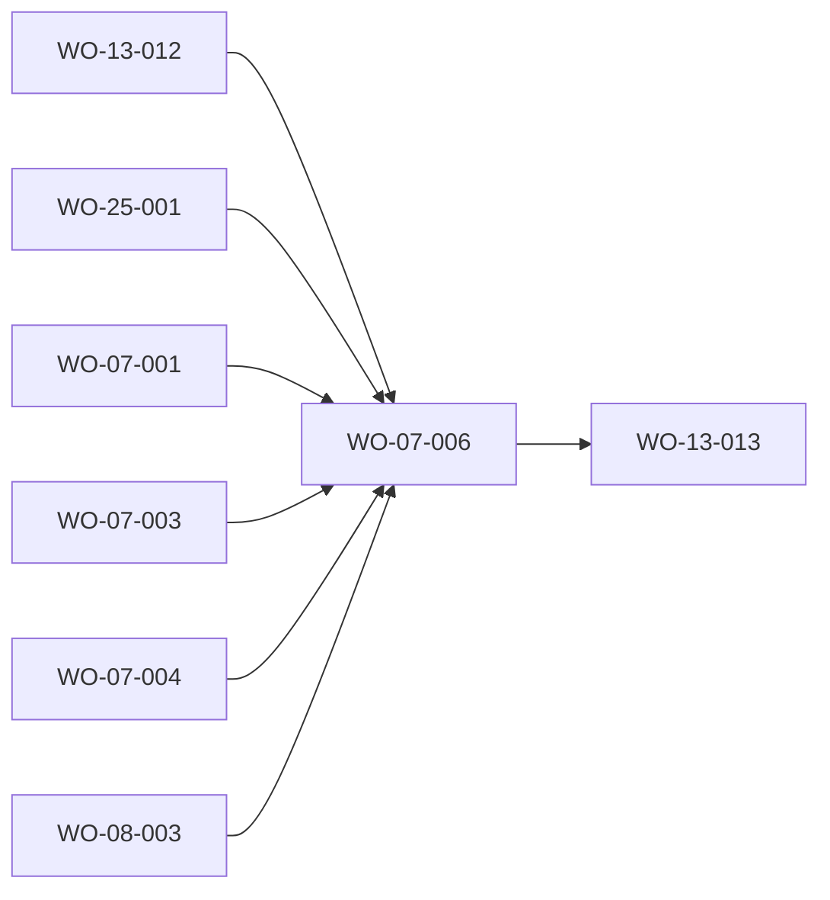

# FRD-07 — Configuración · feature blueprint (v2 «Órbita»)

> **Source-of-truth hierarchy:** `FRD > FDD > design-tokens > blueprint > work order`.
> This is the **per-FRD blueprint** (DR-049): how the Configuración surface is implemented on top of
> the platform in [`docs/product/architecture.md`](../../product/architecture.md) (stack §2, read-only
> invariant §1/§7, `src/lib/**` data layer §6, route map, copy accessor [ADR-0013](../../adr/ADR-0013-typed-copy-accessor.md),
> the Órbita contract [ADR-0012](../../adr/ADR-0012-adopt-orbita-design-system.md)). It does not restate the platform.
> It is a v2 revision of the v1 blueprint: the readers and the factory-source mapping are kept; the UI design is the
> frozen Órbita one (`fdd.md` + `mocks/configuration.html` + the twelve oracle states).

## 1. Feature summary

A **read-only** view of what is configured in the factory, at `/configuration`: a **Resumen** hub (one search
across the four catalogs, four count tiles, «Tus comandos») and four catalogs, **Habilidades · Agentes · Reglas de
decisión · Estándares**, each a searchable, filterable list with a detail (skills, agents and standards open a
dialog; a decision rule opens as an inline accordion). Everything is **derived at read time** from the canonical
factory sources (`plugin/skills/`, `plugin/agents/`, `factory/decisions/registry.yaml`, `factory/standards/`),
never hand-copied (DR-046), and a source that cannot be read shows an explicit error notice, never an empty
catalog (DR-078). To change configuration the owner edits the files or uses Claude Code; Mission Control only
reflects it, and a copy button only writes a command string to the clipboard.

v2 removes what the design dropped (owner decision 2026-10-21 and the removal rule of the work-order map, §0.6): the
skill mini-flow and the workflow explainer, the decision-rule explainer, the «New decision rule» and «New standard»
buttons, and agent level, title and XP with the pixel-art avatar for every agent. Documentación's Referencia now
points here (FRD-08) instead of embedding these components.

## 2. Source mapping (architecture §6)

| Source | Module | What FRD-07 reads | Shape note |
|---|---|---|---|
| `plugin/skills/<slug>/SKILL.md` | `src/lib/reference/reference.ts` | slug (directory name), `description`, body | slug is the **directory name**, never a `name:` field; invoked as `/pandacorp:<slug>`. `runsIn`, `internal`, `produces` and the used `agents` are **derived** (heuristics on description and body), never invented; an undeclared scope is group «Otras». |
| `plugin/agents/<id>.md` | `src/lib/reference/reference.ts` | `name`, `description`, `model`, `effort`, `tools`, body | A missing `model` is the «Modelo heredado» tier. `effort` is normalised to `high / medium / low`; any other value or none shows no effort chip (nothing is guessed). |
| `factory/decisions/registry.yaml` | `src/lib/registry/registry.ts` | `decisiones[]`: `id`, `patron`, `default`, `requiere_humano`, optional `nota` | `requiere_humano` drives the Auto / Tu OK chip and the approval filter. |
| `factory/standards/*.md` | `src/lib/standards/standards.ts` | filename, H1, body, `domain`, `severity` (MUST / SHOULD / MAY), `enforcement`, `summary` | Frontmatter first; the filename-keyed derivation map is the fallback so no standard lacks metadata (the v1 owner flag about adding frontmatter to the factory standards is unchanged and still open). |

The factory root is `resolveFactoryRoot()` (FRD-01), overridable by `PANDACORP_FACTORY_ROOT`. Tests use hermetic temp trees and never the default root (LESSON-0450).

## 3. Components and interfaces

### Interfaces (`src/lib/**`)

- **`IF-07-reference`** (existing, extended additively; REQ-07-002, REQ-07-004 to REQ-07-008, REQ-07-011): `readSkills()` / `readAgents()` keep their signatures for their other consumers (`self-suggest`, history). New: result-typed variants `readSkillCatalog()` and `readAgentCatalog()` returning `{ ok: true, data } | { ok: false, source, reason }`, the array readers delegating to them (one derivation, two thin views, DR-115). `AgentRef` gains `tools: string[]` and `effort: "high" | "medium" | "low" | null`.
- **`IF-07-registry`** (existing, extended; REQ-07-009): `readDecisionRules()` unchanged; new `readDecisionRuleCatalog()` result variant.
- **`IF-07-standards`** (existing, extended; REQ-07-010): `readStandards()` unchanged; new `readStandardCatalog()` result variant.
- **`IF-07-catalogs`** (new, `src/lib/reference/configurationCatalogs.ts`; REQ-07-001, REQ-07-013): `loadConfigurationCatalogs(): ConfigurationCatalogs`, wrapped in `React.cache` so a request reads each source once. It returns the four `CatalogResult`s plus the facts every surface needs derived once: hub counts (owner commands, internal engines, agents per tier, rules needing the owner's OK, mandatory and recommended standards), the owner-command list, the agent-to-skills inversion (cross-navigation both ways, REQ-07-008) and the domain facet counts. No component derives these again.

### Components (`src/app/configuration/`)

- **`CMP-07-config-page`** — `page.tsx` and the unchanged `[...segments]/page.tsx` codec adapter (Server Components): load `IF-07-catalogs`, pass DTOs. → REQ-07-001.
- **`CMP-07-config-shell`** — `ConfigurationShell.tsx` (client boundary): `PageHead`, the `Tabs` navigation «Secciones de configuración», URL state (section, item, search term, filters) through the FRD-25 codec. → REQ-07-001, REQ-07-013.
- **`CMP-07-config-hub`** — `_components/ConfigHub/`: search, count tiles, «Tus comandos» (`CopyText`), «Resultados». → REQ-07-004, AC-07-013.1.
- **`CMP-07-skills-catalog`** — `_components/SkillsCatalog/`: search, type chips, three scope groups, rows with copy or «Motor interno». → REQ-07-002, REQ-07-004 to REQ-07-006, AC-07-013.2.
- **`CMP-07-skill-dialog`** — `_components/SkillDialog/`: kicker, command title, where-it-runs and who-runs-it chips, description, «Agentes:» cross-navigation, command chip, «Definición completa». → REQ-07-003, REQ-07-006 to REQ-07-008, REQ-07-011 (full `SKILL.md` as markdown).
- **`CMP-07-agents-catalog`** — `_components/AgentsCatalog/`: tier groups with one-line explanation, agent cards with `Avatar` and effort chip. → REQ-07-002, REQ-07-011, AC-07-013.3.
- **`CMP-07-agent-dialog`** — `_components/AgentDialog/`: model and effort chips, «Herramientas:», «Lo usan:» cross-navigation, «Definición completa». → REQ-07-003, REQ-07-008, REQ-07-011.
- **`CMP-07-rules-catalog`** — `_components/RulesCatalog/`: approval chips, rows with Auto / Tu OK chip, 30 per page with `MoreBar`, inline accordion. → REQ-07-002, REQ-07-003, REQ-07-009, AC-07-013.4.
- **`CMP-07-standards-catalog`** — `_components/StandardsCatalog/`: mandatory first, severity facets, domain select, enforcement line. → REQ-07-002, REQ-07-010, AC-07-013.5.
- **`CMP-07-standard-dialog`** — `_components/StandardDialog/`: kicker «Estándar · <dominio>», chips, markdown. → REQ-07-003, REQ-07-010.
- **`CMP-07-read-error`** — `_components/ReadError/`: the shared `Notice` error variant naming the failing source. → edge case «source cannot be read» (DR-078).

### Reused, not re-created (components.md)

`PageHead`, `Tabs`, `SearchField` / `SelectField`, `Card` + `CardHeader`, `SectionHeading`, `CommandBox` / `CopyText`, `ListRow`, `Chip` family (`FilterChip`), `Avatar`, `MoreBar`, `Dialog`, `Markdown`, `Notice`. Nothing new is introduced by this FRD.

## 4. Contract: URL state (FRD-25, ADR-0010)

Path: `/configuration[/:section[/:item]]`, `section` ∈ `skills · agents · rules · standards`; `item` is the skill slug, agent id, rule id (the open accordion row) or standard id. Query keys carry the search term (`q`) and the filters (`type` for Habilidades, `approval` for Reglas, `severity` and `domain` for Estándares). The codec already owns the path families (`configSection`, `configItem`); the query keys above are requested from WO-25-001 (ledger). Typing replaces history; an unknown section or item is the bounded not-found; no URL write ever runs a mutation.

## 5. Read-only and security posture

Every reader is `fs.read*` (architecture §7); no write path exists in this feature. The copy buttons write only the command string to the clipboard and never run it or call Claude. Shown content (descriptions, rule text, standards markdown) keeps its source language and is rendered through `Markdown` or as text, never as raw HTML. No personal data beyond the factory repo is touched. No new environment variable, secret or external service.

## 6. Dependencies and risks

- **FRD-08 coupling.** Until WO-08-003 lands, Documentación's reader imports this surface's v1 components (`AgentList`, `SkillsSection`, `StandardsSection`, `DecisionRulesSection`, `AgentDetail`). WO-07-006 rewrites them, so it depends on WO-08-003 (which removes that import) and builds in W4, one wave after the map's W3. See the ledger.
- **Removals owned elsewhere.** The `FlowGraph` component and the skill-flows data (WO-13-013) and the agent XP engine `src/lib/gamification/agents.ts` (WO-13-013) are deleted in W7 once nothing here references them; WO-07-006 removes every reference.
- **Open design items (DR-130).** The read-error wording and «what it produces» (REQ-07-007) are not drawn in the captured states; both are ledger items for DESIGN, neither blocks the other states.
- **Perf.** Four small directory reads per request, cached per request; 48 rules and 27 skills need no virtualization.
- Lessons that shaped this design: LESSON-0450 (hermetic readers: tests never use the default root), LESSON-0490 (the tool's own chrome is Spanish, shown content keeps its language), LESSON-0484 (one hue per catalog, red/amber/green only for status).

## 7. Traceability (REQ → CMP / IF → work order)

| Requirement | Component(s) / interface(s) | Work order |
|---|---|---|
| REQ-07-001 Resumen hub and the four catalogs | `CMP-07-config-page`, `CMP-07-config-shell`, `CMP-07-config-hub`, `IF-07-catalogs` | WO-07-006 |
| REQ-07-002 name and real description per item | the four catalog components, `IF-07-reference` / `IF-07-registry` / `IF-07-standards` | WO-07-006 (readers WO-07-001, WO-07-003, WO-07-004) |
| REQ-07-003 detail: dialog or inline accordion | `CMP-07-skill-dialog`, `CMP-07-agent-dialog`, `CMP-07-standard-dialog`, `CMP-07-rules-catalog` | WO-07-006 |
| REQ-07-004 copy-only command chip | `CMP-07-config-hub`, `CMP-07-skills-catalog`, `CMP-07-skill-dialog` | WO-07-006 |
| REQ-07-005 skills grouped by run location | `CMP-07-skills-catalog`, `IF-07-reference` (`runsIn`) | WO-07-006 |
| REQ-07-006 «Motor interno» / «Comando tuyo» | `CMP-07-skills-catalog`, `CMP-07-skill-dialog`, `IF-07-reference` (`internal`) | WO-07-006 |
| REQ-07-007 skill detail and full definition (mini-flow out of v2) | `CMP-07-skill-dialog` | WO-07-006 |
| REQ-07-008 skills ↔ agents cross-navigation | `CMP-07-skill-dialog`, `CMP-07-agent-dialog`, `IF-07-catalogs` (inversion) | WO-07-006 |
| REQ-07-009 all rules with Auto / Tu OK, accordion (explainer and button out of v2) | `CMP-07-rules-catalog`, `IF-07-registry` | WO-07-006 |
| REQ-07-010 standards: domain select, severity, enforcement, dialog (button out of v2) | `CMP-07-standards-catalog`, `CMP-07-standard-dialog`, `IF-07-standards` | WO-07-006 |
| REQ-07-011 agents: avatar, model chip, effort chip (pixel art, level, title out of v2) | `CMP-07-agents-catalog`, `CMP-07-agent-dialog`, `IF-07-reference` | WO-07-006 |
| REQ-07-012 (Out of v2: XP bar, model explanation) | none; removed. Model assignment is explained once per tier group (AC-07-013.3) | WO-07-006 (removal) |
| REQ-07-013 hub, search, tiers, filters (AC-07-013.1 to AC-07-013.5) | `CMP-07-config-hub`, the four catalogs, `IF-07-catalogs` | WO-07-006 |

Every live AC (AC-07-013.1 to AC-07-013.5) is owned by WO-07-006; the three legacy reader work orders are kept live as history and own no live AC.

## Build Plan

> The build engine reads this table; it does not infer dependencies. All artifact globs are literal (no brace expansion) and match each work order's frontmatter.

| WO | Depends on | Artifacts (globs) | Foundation | Parallel with |
|---|---|---|---|---|
| WO-07-001 | WO-01-001 | `src/lib/reference/reference.ts`, `src/lib/reference/_tests/reference.test.ts`, `src/tests/fixtures/plugin-reference/**` | false | W2 (with WO-07-003, WO-07-004) |
| WO-07-003 | WO-01-001 | `src/lib/registry/registry.ts`, `src/lib/registry/_tests/registry.test.ts` | false | W2 (with WO-07-001, WO-07-004) |
| WO-07-004 | WO-01-001 | `src/lib/standards/standards.ts`, `src/lib/standards/_tests/standards.test.ts` | false | W2 (with WO-07-001, WO-07-003) |
| WO-07-006 | WO-13-012, WO-25-001, WO-07-001, WO-07-003, WO-07-004, WO-08-003 | `src/app/configuration/**`, `src/lib/reference/**`, `src/lib/registry/**`, `src/lib/standards/**`, `e2e/configuration.spec.ts`, `e2e/persistent-navigation/configuration.spec.ts` | false | W4 (alone in FRD-07) |

- **Order and parallelism.** The three reader work orders are VERIFIED history (kept live, no live AC) and are siblings in W2. WO-07-006 follows everything it consumes and builds alone within FRD-07.
- **Disjoint artifacts.** Within a wave the globs above do not overlap (the three W2 readers each own their own module; WO-07-006's `src/lib/{reference,registry,standards}/**` globs are in a later wave than the legacy files they extend). Other W4 work orders (WO-03-007, WO-10-016, WO-02-016, WO-17-008) write other directories.
- **Integration order.** FRD-13 primitives (WO-13-012) → URL codec (WO-25-001) → readers (WO-07-001/003/004) → Documentación UI (WO-08-003, removes the embed of this surface's components) → WO-07-006. WO-13-013 (W7) depends on WO-07-006 and then deletes `FlowGraph`, the skill-flows data and the agent XP engine.
- **Cross-FRD dependencies.** FRD-13 (WO-13-012), FRD-25 (WO-25-001), FRD-08 (WO-08-003), FRD-01 (WO-01-001). Consumers of this FRD's readers outside the surface: `src/lib/self-suggest` (array readers, unchanged signatures).
- **Visual spec for UI work orders (DR-054).** WO-07-006 reproduces `mocks/configuration.html` (sections `config-hub`, `config-hub-search`, `config-skills`, `config-skill-dialog`, `config-agents`, `config-agent-dialog`, `config-rules`, `config-rules-search`, `config-rule-detail`, `config-standards`, `config-standards-must`, `config-standard-dialog`) and the oracle states of the same ids, with `fdd.md` as the design; assets: exported SVG icons via `Icon`, agent sprites staged in `public/` by WO-13-010.

## Reconciliation (2026-10-22, binding)

- WO-07-006 is W4 (it depends on WO-08-003, which removes the Documentación embed of this surface's components
  first); `e2e/persistent-navigation/configuration.spec.ts` and the split unit file
  `src/app/configuration/_tests/persistentNavigation.test.tsx` (both created by WO-25-001 in W0) are updated here.
- The page renders no `<main>` (the shell owns `main#content`); tests querying `getByRole("main")` are updated here.
- WO-25-001 ships the keys `q`, `type`, `approval`, `severity`, `domain`; legacy `/manual/reference/...` lands on
  `/configuration/...` through `normalizeLegacyNavigation`, applied by WO-08-003 at the Documentación boundary.
- Reviewer suites this work order rewrites the surface of (`src/app/configuration/_tests/frd07*.reviewer*`) are
  derogated, never edited, and listed in the WO for the FRD-07 gate reviewer to re-bless. Whether the per-WO gate
  tolerates a derogated reviewer suite of the FRD under build is an engine question escalated to the lead (ledger
  F, map §3.3.3); the plan does not assume it.

## Superseded (v1 history)

- WO-07-005 — Configuración UI surface (re-anchor to prototype). Superseded by WO-07-006 (`implementation_status` stays VERIFIED as history).

## Readiness check (DR-100)

Every `REQ-07-001` to `REQ-07-013` maps to a component or interface above; every live AC (AC-07-013.1 to AC-07-013.5) is covered by exactly one work order (WO-07-006); `dependsOn` is acyclic and every referenced work order exists; wave-parallel work orders have disjoint artifacts; the foundation is complete (every primitive the mock references is a WO-13-0xx deliverable); the platform data model is unchanged (no entity of its own, `data-model.json` untouched); no unresolved clarification marker survives in this feature's documents.
