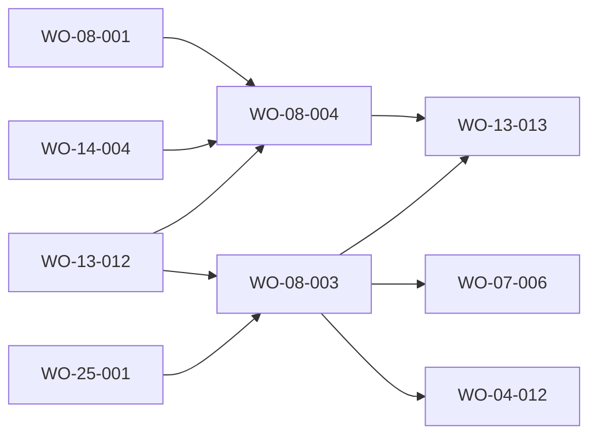

# FRD-08 — Documentación · feature blueprint (v2 «Órbita»)

> **Source-of-truth hierarchy:** `FRD > FDD > design-tokens > blueprint > work order`.
> This is the **per-FRD blueprint** (DR-049) for the Documentación surface (route folder `src/app/manual`, interface name
> «Documentación»). It references the platform [`architecture.md`](../../product/architecture.md) (stack §2,
> read-only invariant §1/§7, `src/lib/**` §6, route map, copy accessor [ADR-0013](../../adr/ADR-0013-typed-copy-accessor.md),
> Órbita contract [ADR-0012](../../adr/ADR-0012-adopt-orbita-design-system.md)) and the [FRD-07 blueprint](../frd-07-configuration/blueprint.md),
> which now owns the catalogs. It is a v2 revision of the v1 blueprint.

## 1. Feature summary

The navigable face of the factory's know-how, organised with Diátaxis as four authored groups, **Tutorial · Guías ·
Conceptos · Workflows**, plus a **Referencia** entry that points to Configuración (FRD-07) where the catalogs live
(one catalog, one set of cards, derived from the factory, DR-046). v2 shape: a home that routes the reader in, one
full-text search with snippets, and a reader with breadcrumbs, a position counter (or the tutorial's «Paso X de Y»
bar), previous and next within the group and the page index at the right (folded behind a control below 900 px).
The authored content (38 pages today) is refreshed to the v2 factory and the v2 app, and the interactive skill flow
graph with its curated explainers is removed (owner default O2: the skill-flows data and `FlowGraph` leave the app).

Two work orders split the surface: **WO-08-003** is the UI (shell, home, search, reader, index, not-found, the shared
`DocIndex` / `Paper` module); **WO-08-004** is the content and the removals (Claude Design sunset wording, retired
Mission Control surfaces, requirements REQ-08-013 to REQ-08-019 re-verified, flow graph off the pages).

## 2. Content model (kept from v1, still true)

- **Authored pages** live in `content/manual/<group>/<slug>.md` and are indexed by `readManualPages()` (`src/lib/manual/manual.ts`, WO-08-001, history): `group`, `slug`, `title`, `order`, `body`. A malformed page is skipped with a typed warning. `readServiceManualPages()` (FRD-26) is merged by the page exactly as today.
- **One source of content per page (REQ-08-018, DR-115).** A page with a bespoke renderer (`src/app/manual/manualPages.tsx`, long sections in `_components/*Detail.tsx`, diagrams in `src/components/modules/manual-diagrams/`) takes its content ONLY from that renderer; its `.md` is an index stub (frontmatter, H1, one-line summary). A page without a renderer renders its `.md` body through `Markdown`. Guards: `manualSingleSource.test.ts`, `conceptEquipo.test.tsx`.
- **Roster.** «El equipo» bios and the team diagram share one `GROUPS` roster (`TeamDiagram.tsx`); a test fails when an agent is added to `plugin/agents/` without a card (REQ-08-019).
- **Currency (REQ-08-013, REQ-08-017).** Workflow-facing statements are copied from the installed plugin skills and standards (DR-046); the structure page reflects the feature-centric layout (DR-049). v2 adds content tests (sunset wording, retired Mission Control phrases, required topics).
- **No catalogs here (REQ-08-006, REQ-08-007).** Referencia links to `/configuration/<section>`; the Documentación contains no catalog renderer and no `reference` content group.

## 3. Components and interfaces

### Interfaces

- **`IF-08-manual-index`** (existing, WO-08-001): `readManualPages(appRoot?): ManualPage[]`, unchanged. The single source of the page list for home counts, search, index and prev/next.
- **`IF-08-search-index`** (new, `src/app/manual/_components/DocsSearch/`; AC-08-020.2). `buildSearchIndex(pages, extractText): SearchEntry[]` and `searchPages(index, query): SearchHit[]`, both pure. `extractText(page)` is injected: for a page with a bespoke renderer it is the text of the renderer's static markup (the shell lazily imports `react-dom/server` in the client on the first non-empty term and memoises the index for the session), for any other page the `.md` body stripped of markdown syntax. `searchPages` matches title and text, case- and accent-insensitively; hits are ordered title matches first, then by group order and page `order`; each hit carries `{ page, group, snippet }` where the snippet is a window of roughly 120 characters around the first match, with an ellipsis on each truncated side. A page whose renderer cannot be extracted is indexed by title only, and a test that extracts every registered renderer fails if any throws (no silent loss, DR-078).
- **`IF-08-legacy-redirect`** (new, in `[...segments]/page.tsx`): the closed table `reference/commands|agents|rules|standards[/<item>]` → `/configuration/skills|agents|rules|standards[/<item>]`; any other `reference/*` path is not found. The item is carried as one URL-encoded segment.
- **`IF-08-doc-index`** (new, `src/components/modules/DocumentReader/DocIndex.tsx` and `DocItem`; components.md row): props `groups: { id, label, count, items: { id, label, href, current? }[] }[]`, `query`, `onQuery`, optional `typeFilters` (the project Documentos tab uses them; the Documentación does not), `toggleLabel` (the folded control: «Índice · <página>» in the Documentación, «Elegir documento · N» in Documentos). From 900 px it is rendered at the right; below it is behind a `button` that opens it above the page and returns focus to the button on close.
- **`IF-08-paper`** (new, `src/components/modules/DocumentReader/Paper.tsx`): typed document reader, props `type`, `path`, content as children (a `Markdown`); header with the type chip, the path and a copy button. Consumed by WO-04-012.

### Components (`src/app/manual/`)

- **`CMP-08-docs-shell`** — `page.tsx`, `ManualShell.tsx`, `[...segments]/page.tsx`, `types.ts`: `PageHead`, URL state (`/manual/:group/:page`, `q`, `index`) through the FRD-25 codec, home/search/reader/not-found selection. → REQ-08-001, REQ-08-002.
- **`CMP-08-docs-home`** — `_components/DocsHome/` (`DocsGroupCard`, `DocsSteps`): «Empieza aquí», «Guías para el día a día», «Explorar por tipo» with Referencia. The curated link lists (the four essentials, the six daily guides) are constants whose slugs a test resolves against the page index. → AC-08-020.1, REQ-08-003, REQ-08-007.
- **`CMP-08-docs-search`** — `_components/DocsSearch/`: the results card over `IF-08-search-index`. → AC-08-020.2.
- **`CMP-08-doc-reader`** — `DocReader.tsx`: `Crumbs`, counter or tutorial bar, body (renderer or `Markdown`), previous and next cards. → AC-08-020.3, REQ-08-002, REQ-08-003.
- **`CMP-08-doc-nav`** — `DocNav.tsx`: builds the `DocIndex` groups (including the Referencia links) from the page list. → AC-08-020.3.
- **`CMP-08-docs-not-found`** — the `EmptyState` of the unknown page. → REQ-08-001.
- **`CMP-08-concept-pages`** — the authored content (WO-08-004): `manualPages.tsx`, `_components/*Detail.tsx`, `manual-diagrams/*`, `content/manual/**` stubs, `ManualLink`. → REQ-08-004, REQ-08-005, REQ-08-013 to REQ-08-019.

`ManualNavContext` keeps its interface (`goToSkill`, `goToAgent`, `goToManual`); `ManualShell` implements the first two as links to the Configuración item URLs and the third as a reader navigation. The two Configuración-facing members are dead once `FlowGraph` is deleted; WO-13-013 removes them (ledger).

### Reused (components.md)

`PageHead`, `Crumbs`, `SearchField`, `Card` + `CardHeader`, `ListRow`, `Chip`, `Button`, `Markdown`, `CommandBox`, `Avatar`, `EmptyState`, `Icon`.

## 4. Contract: URL state (FRD-25, ADR-0010)

`/manual` (home), `/manual/:group/:page` with `group` ∈ `tutorial · guides · concepts · workflows` (pages by slug). Query keys: `q` (the search term, shared by the home search and the index search) and `index` (the folded index open on a narrow screen). The path families are already in the codec; `q` and `index` are requested from WO-25-001 (ledger). Typing replaces history. Legacy `reference/*` paths redirect as above. An unknown group or page is the bounded not-found of FRD-25, rendered in place.

## 5. Read-only and security posture

Reads only (`fs.read*` of the app's own `content/manual`); no write path. Commands are shown to copy and never run. The legacy redirect maps to fixed Configuración paths (closed section list, one encoded item segment): no open redirect. No personal data, secret or external service is touched. Private account identities never enter public Documentación content (FRD-26 rule, unchanged).

## 6. Dependencies and risks

- **Search text extraction.** Full-text search over bespoke pages needs their rendered text (the stub `.md` carries none by REQ-08-018). The chosen design renders them on the client lazily; risk: a renderer that depends on a provider. Mitigation: renderers use default (no-op) contexts; the extraction test covers every registered page. Fallback if extraction ever proves too heavy: title-only entries for the affected pages, reported by the test.
- **Oracle drift on content.** The frozen prototype still draws «Portfolio → Party» in the `g-modo` and tutorial states; REQ-08-013 removes it. Ledger item for DESIGN; the FRD wins.
- **Cross-FRD ordering.** WO-08-003 removes the embed of Configuración's v1 components, so WO-07-006 depends on it; WO-04-012 consumes `DocIndex` and `Paper`; WO-13-013 deletes `FlowGraph`, `skill-flows.ts`, `workflow-flows.ts` and the dead nav members after both W3 work orders.
- Lessons that shaped this design: LESSON-0490 (the tool's chrome is Spanish; authored page bodies and shown content keep their language), LESSON-0113 (a documented mechanism is a proposal until its call site exists: the guard tests name their files), LESSON-0123 (no em or en dash in new copy).

## 7. Traceability (REQ → CMP / IF → work order)

| Requirement | Component(s) / interface(s) | Work order |
|---|---|---|
| REQ-08-001 surface named «Documentación», not-found page | `CMP-08-docs-shell`, `CMP-08-docs-not-found`, `CMP-08-concept-pages` (content audit) | WO-08-003, WO-08-004 |
| REQ-08-002 reading area and index at the right, folded below 900 px | `CMP-08-doc-reader`, `CMP-08-doc-nav`, `IF-08-doc-index` | WO-08-003 |
| REQ-08-003 four groups plus Referencia → Configuración | `CMP-08-docs-home`, `CMP-08-doc-nav`, `IF-08-manual-index` | WO-08-003 |
| REQ-08-004 pages cover the required topics | `CMP-08-concept-pages` | WO-08-004 |
| REQ-08-005 sufficient for a no-context reader | `CMP-08-concept-pages` | WO-08-004 |
| REQ-08-006 catalogs derived, never hand-copied | none here: FRD-07 `IF-07-catalogs`; this FRD asserts it holds no catalog | WO-08-003, WO-08-004 (test), WO-07-006 |
| REQ-08-007 Referencia points to Configuración | `CMP-08-docs-home`, `CMP-08-doc-nav`, `IF-08-legacy-redirect` | WO-08-003 |
| REQ-08-008 to REQ-08-010, REQ-08-012 (Out of v2: curated explainers, flow graph, cross-navigation, skill-flows data) | none; removed | WO-08-004 (pages), WO-13-013 (files) |
| REQ-08-011 full `SKILL.md` as markdown | FRD-07 `CMP-07-skill-dialog` | WO-07-006 |
| REQ-08-013 pages reflect the current workflow; sunset wording; `g-modo` refresh | `CMP-08-concept-pages` | WO-08-004 |
| REQ-08-014 to REQ-08-016 multi-runtime Concept (DR-133) | `CMP-08-concept-pages` (`ConceptMultiRuntime`, `RuntimeComparison`, `MultiRuntimeDiagram`) | WO-08-004 |
| REQ-08-017 feature-centric structure page | `CMP-08-concept-pages` | WO-08-004 |
| REQ-08-018 bespoke page = renderer only, `.md` is an index stub | `CMP-08-doc-reader`, `CMP-08-concept-pages`; guard `manualSingleSource.test.ts` | WO-08-004 |
| REQ-08-019 «El equipo» bio per agent | `CMP-08-concept-pages` (`TeamDiagram`, bios); guard `conceptEquipo.test.tsx` | WO-08-004 |
| REQ-08-020 home, search, reader (AC-08-020.1 to AC-08-020.3) | `CMP-08-docs-home`, `CMP-08-docs-search`, `IF-08-search-index`, `CMP-08-doc-reader`, `IF-08-doc-index` | WO-08-003 |

Every live AC (AC-08-020.1 to AC-08-020.3) is owned by WO-08-003; WO-08-004 and the kept WO-08-001 own none.

## Build Plan

> The build engine reads this table; it does not infer dependencies. All artifact globs are literal and match each work order's frontmatter.

| WO | Depends on | Artifacts (globs) | Foundation | Parallel with |
|---|---|---|---|---|
| WO-08-001 | WO-01-001 | `src/lib/manual/manual.ts`, `src/lib/manual/_tests/manual.test.ts` | false | W2 |
| WO-08-003 | WO-13-012, WO-25-001 | `src/app/manual/page.tsx`, `src/app/manual/ManualShell.tsx`, `src/app/manual/DocReader.tsx`, `src/app/manual/DocNav.tsx`, `src/app/manual/ManualNavContext.tsx`, `src/app/manual/types.ts`, `src/app/manual/[...segments]/**`, `src/app/manual/_components/DocsHome/**`, `src/app/manual/_components/DocsSearch/**`, `src/components/modules/DocumentReader/**`, `src/app/manual/_tests/page*.test.tsx`, `src/app/manual/_tests/docs-home*.test.tsx`, `src/app/manual/_tests/docs-search*.test.tsx`, `src/app/manual/_tests/doc-reader*.test.tsx`, `src/app/manual/_tests/persistentNavigation.test.tsx`, `src/app/manual/_tests/visual-reanchor*.test.tsx`, `e2e/documentation.spec.ts`, `e2e/persistent-navigation/manual.spec.ts` | false | W3 (with WO-08-004) |
| WO-08-004 | WO-13-012, WO-08-001, WO-14-004 | `src/app/manual/manualPages.tsx`, `src/app/manual/_components/*Detail.tsx`, `src/app/manual/_components/ManualLink.tsx`, `content/manual/**/*.md`, `content/manual/wo-08-005.content.test.ts`, `src/lib/manual/**`, `src/components/modules/manual-diagrams/**`, `src/app/manual/_tests/manual-content*.test.tsx`, `src/app/manual/_tests/manualPages*.test.tsx`, `src/app/manual/_tests/conceptEquipo.test.tsx`, `src/app/manual/_tests/manualSingleSource.test.ts` | false | W3 (with WO-08-003) |

- **Order and parallelism.** WO-08-001 is VERIFIED history (W2). WO-08-003 and WO-08-004 are siblings in W3 and run in parallel: their artifacts are disjoint file by file (shell, reader and shared module versus renderers, details, content, diagrams and their tests; the test globs are split by file prefix). `src/lib/manual/**` is WO-08-004's this wave; WO-08-003 does not touch it.
- **Integration order.** FRD-13 primitives (WO-13-012) and the URL codec (WO-25-001) → WO-08-003 / WO-08-004 → WO-04-012 (mounts `DocIndex` and `Paper`), WO-07-006 (rewrites the Configuración components after WO-08-003 removed their embed) → WO-13-013 (deletes `FlowGraph`, `skill-flows.ts`, the dead nav members; `workflow-flows.ts` goes earlier, with WO-08-004, which removes its only importer).

## Reconciliation (2026-10-22, binding)

- **Search.** Lazy client-side text extraction of each registered renderer with `react-dom/server`
  `renderToStaticMarkup` (installed; no new dependency), built on the first non-empty term and memoised, with a
  test that every registered renderer is extractable. A build-time generated index is rejected: it would be a
  second replica of the page text (DR-115).
- **`src/app/manual/_tests/persistentNavigation.test.tsx`** has one owner, WO-08-003 (W3): WO-25-001 (W0) moves its
  non-Manual cases next to their owners (Nav, Backlog, Propuestas, Configuración), so WO-19-002 no longer writes it.
  This fixed the one W3 artifact overlap `waves.mjs` reported.
- **`e2e/persistent-navigation/manual.spec.ts`** is WO-08-003's alone (WO-08-004 writes no route or reader).
- WO-08-003 applies `normalizeLegacyNavigation` at the Documentación boundary (`/manual/reference/:catalog/:item` →
  `/configuration/:catalog/:item`, catalogs `skills` (from `commands`), `agents`, `rules`, `standards`), removes
  `DocReader.tsx`'s `AgentLevelResult` type import, and renders no `<main>`.
- WO-08-004 deletes `src/lib/manual/workflow-flows.ts`; WO-13-013 deletes `skill-flows.ts`, `FlowGraph` and the
  `goToSkill` / `goToAgent` members of `ManualNavContext` with their `ManualShell` implementation.
- The empty-search sentence is captured (`docs-search-empty`, WO-08-003's Visual reference).
- **Cross-FRD dependencies.** FRD-13 (WO-13-012), FRD-25 (WO-25-001), FRD-14 (WO-14-004, the feedback page whose commands must stay), FRD-01 (WO-01-001). Consumers: FRD-04 (WO-04-012), FRD-07 (WO-07-006), FRD-13 (WO-13-013).
- **Visual spec for UI work orders (DR-054).** WO-08-003 reproduces `mocks/documentation.html` (`docs-home`, `docs-search`, `docs-page`, `docs-page-index-open`, `docs-page-not-found`, `docs-page-tutorial`, `docs-page-guide`); WO-08-004 supplies the content of `docs-page-guide`, `docs-page-team` and `docs-page-multi-runtime` and the `el-pipeline` design block. `fdd.md` is the design; assets: exported SVG icons via `Icon`, agent sprites staged in `public/` by WO-13-010.

## Superseded (v1 history)

- WO-08-002 — Documentación UI surface (re-anchor to prototype). Superseded by WO-08-003 and WO-08-004 (`implementation_status` stays VERIFIED as history).

## Readiness check (DR-100)

Every `REQ-08-001` to `REQ-08-020` maps to a component, an interface or an explicit removal above; every live AC (AC-08-020.1 to AC-08-020.3) is covered by exactly one work order (WO-08-003); `dependsOn` is acyclic and every referenced work order exists; the two W3 work orders have disjoint artifacts by design; the foundation is complete (primitives from WO-13-010..012); the platform data model is unchanged; no unresolved clarification marker survives in this feature's documents.
