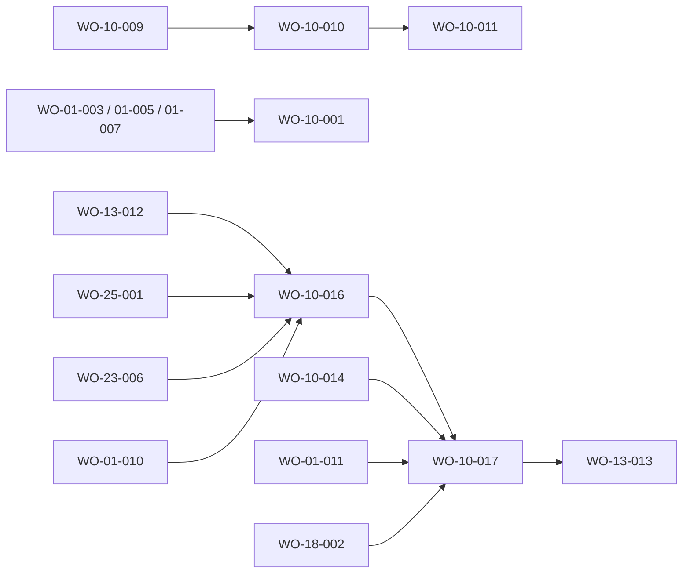

# FRD-10 — Logros (Achievements Hall) · feature blueprint (v2 «Órbita»)

> **Source-of-truth hierarchy:** `FRD > FDD > design-tokens > blueprint > work order`.
> This is the **per-FRD blueprint** (DR-049) for Logros, the page of achievements that are also stats that grow. It
> references the platform [`architecture.md`](../../product/architecture.md) (stack §2, read-only invariant §1/§7, the
> `src/lib/**` data layer §6, route map, copy accessor [ADR-0013](../../adr/ADR-0013-typed-copy-accessor.md), the Órbita
> contract [ADR-0012](../../adr/ADR-0012-adopt-orbita-design-system.md), the stats read-model
> [ADR-0004](../../adr/ADR-0004-materialized-stats-read-model.md)), the [FRD-23 blueprint](../frd-23-materialized-stats-read-model/blueprint.md)
> (the Estadísticas data source), the [FRD-09 blueprint](../frd-09-gamification/blueprint.md) (the XP engine and rank table) and the
> design detail in [`docs/achievements.md`](../../achievements.md). It is a v2 revision: the engine and the report readers are
> kept (they are VERIFIED history); the UI is the frozen Órbita design.

## 1. Feature summary

`/achievements` is five tabs: **Resumen · Misiones · Trofeos · Estadísticas · Rangos**, under one guild hero. Every
number is **computed by reading the factory and the projects** (no stored counters), each trophy, mission and secret
derives from a verifiable real signal, and a value with no source is never a zero: it reads «no cableado», and a counter
whose event was never recorded reads «sin datos aún» (the two are never merged). The Estadísticas tab is the sober
operator report; its figures come from the FRD-23 read-model with a fail-loud live fallback. v2 rebuilds the surfaces
and removes what the design dropped (the NUEVO badge, the estimated-rarity blurb, the summit treatment, the party roster
and record badges in the hero, the chain crown and per-tier date and project, the revealed-secret treatment, the
populated usage lists). Two work orders carry it: **WO-10-016** (frame, hero, Resumen, Misiones, Trofeos, Rangos) and
**WO-10-017** (Estadísticas).

## 2. Where the numbers come from (honesty contract, kept)

| Fact | Source | Reader |
|---|---|---|
| products launched | shipped idea cards ∪ projects at `phase: release`, de-duplicated | `countLaunched` in `src/lib/ideas/ideas.ts` (one bridge resolver, DR-085/DR-115; never re-derived locally) |
| ideas captured and discarded | `factory/ideas/*.md` | `readIdeas` (FRD-01) |
| work orders completed | live `listWorkOrders(path).state === "done"` summed over the portfolio (`workOrdersDoneLive`, DR-092) | `src/lib/work-orders`, `guildState.ts` |
| phases, iterations, flawless launches, PRDs, ADRs, agents, streak, idea→launch record | `status.yaml` history, docs presence, durable events | `readStatus`, `src/lib/docs`, the durable ledger (R9 boundary below) |
| unlock date and project of a trophy | the event or status that triggered it | `src/lib/events`, `readStatus` |
| weekly WO-verified series, phase transitions, scalars, lessons, funnel | git history of the committed artifacts, ideas, memory | the report readers (section 4) via the FRD-23 resolver |

Counters reflect cumulative real history; endowed progress shows the progress already achieved, never inflated.
**R9 accounting boundary (kept):** production trophy predicates receive only the durable ledger's oracle-materialized events
(`ReaderData.durableEvents`; an empty array is an explicit boundary); signals with no durable oracle stay visible as
telemetry and honestly remain locked for durable achievements.

## 3. The engine (history, consumed unchanged)

`src/lib/achievements/` is a pure package: `signals.ts` (`signalsFor`, the single memoised derivation of every real-event
aggregate), `readerData.ts`, `catalogue/` (one file per axis plus secrets and helpers), `predicates.ts` (assembler),
`definitions.ts` (chains and sagas), `tiers.ts` (tier and rarity colours), `stats.ts` / `achievements.ts` (`computeStats`,
`computeChains`, `computeUniques`, `computeSeals`, `computeSecrets`, `metricLevel`). The events reader surfaces the enriched
real fields and fails loud on an unrecognised enriched shape (WO-10-009). WO-10-016 removes only `rarityBlurb` from
`tiers.ts` (its single v2 consumer is gone); fields the v2 surfaces no longer render (`isNew`, per-tier unlock date and
project) stay in the engine untouched.

## 4. Interfaces

### Engine and report (existing, consumed unchanged)

`IF-10-signals`, `IF-10-stats`, `IF-10-metric-level`, `IF-10-chains`, `IF-10-uniques`, `IF-10-seals`, `IF-10-secrets`
(section 3); report readers under `src/lib/achievements/report/`, all read-only and fail-loud (DR-078): `IF-10-flow-series`
(WO-verified and ideas-captured per ISO week, with the `created`-less exclusion count), `IF-10-phase-transitions`
(per-project transitions with the reopen flag), `IF-10-scalars` (FRDs, commits, decisions, projects, tests-passing or
explicit null), `IF-10-usage` (workflows and effort mix, pure over the event snapshot), `IF-10-funnel` (funnel, WIP,
conversion, discards without reason), `IF-10-lessons`, and the pure `factoryVerdict` / `nextActions` rules. Per the FRD-23
ADR the Informe reads the materialized stores first (aggregate index, per-project portada, factory store) and falls back
to these live readers only on a missing, stale or corrupt store, independently per scope.

### New in v2

- **`IF-10-view-rules`** (`src/app/achievements/_utils/`, WO-10-016; AC-10-028.1 to AC-10-028.4): pure functions over the engine's DTOs: mission ordering by closeness to the next tier (zero progress last), nearest-trophy selection (lowest rarity per category, three when a category is active, ties by catalogue order), era collapse (every era more than one step beyond the current rank), attribute summary (strongest, weakest, without data), recent trophies (the last four).
- **`IF-10-statistics-data`** (`src/app/achievements/_components/Stats/loadStatisticsData.ts`; created as a v1 adapter by WO-10-016, rewritten by WO-10-017): `loadStatisticsData()`, server-side and request-cached, returns the radar/records/ledger inputs, the resolved Informe sources, the usage mix, the usage-source health and the counter provenance. It is the only thing `page.tsx` calls for the Estadísticas tab.
- **`IF-10-usage-source`** (`src/lib/events/eventSourceHealth.ts`, WO-10-017; AC-10-022.3): `eventSourceHealth()` returns `{ ok: true }` or `{ ok: false, kind: "missing" | "invalid-json", source, line? }` for the same files and the same tail window that `readEvents` parses (the reader keeps skipping a malformed line for every other consumer; only the usage band is fail-loud). `events.ts` exports its private source resolver and tail reader so the path logic exists once.
- **`IF-10-stat-provenance`** (`_components/Stats/statProvenance.ts`, WO-10-017; AC-10-026.2, AC-10-028.5): a closed table from each event-fed counter to the event kinds that feed it; a counter reads «sin datos aún» only when its value is 0 and none of its kinds was recorded; otherwise it shows its number (a measured zero included). A scalar with no source reads «no cableado».

## 5. Components (`src/app/achievements/`, `src/components/modules/GuildHero/`)

Route-private components live in `_components/<Name>/` (feature-first); only `GuildHero` is a shared module. Where
components.md names a path, the blueprint records the relocation (a module is relocated, never renamed or forked).

- **`CMP-10-hall-page`** — `page.tsx` + `[...segments]/page.tsx` (Server Components): DTO assembly and codec seeding. → FRD-10#U7.
- **`CMP-10-hall-tabs`** — `_components/HallTabs.tsx` (client): the five-tab `Tabs` frame, a count only on Trofeos, URL state (tab, category, trophy, eras). → FRD-10#U7.
- **`CMP-10-guild-hero`** — `GuildHero` (restyle in place): crest XL, kicker, rank name, XP line, gold bar, three counts. → FRD-10#U9, #U10, #U11.
- **`CMP-10-summary-tab`** — `_components/summary/`: composes `CMP-10-almost-there` (`AlmostThere.tsx`, FRD-10#U17), `CMP-10-seals-card` («Sellos del gremio», #U3), `CMP-10-next-rank-card` (`NextRankCard`, relocated from components.md `_components/NextRankCard.tsx`; AC-10-028.1, #U11), `CMP-10-recent-trophies`, `CMP-10-attributes-card` (compact radar and sentence; AC-10-028.1).
- **`CMP-10-missions-tab`** — `_components/missions/`: spotlight, sagas, `CMP-10-mission-card` (`MissionCard`, the restyle of `ChainCard`, relocated from `ChainCard/`; one layout, always-present bar, uniform footer). → FRD-10#U5, #U12, #U15, #U20, #U21, AC-10-028.2.
- **`CMP-10-trophies-tab`** — `_components/trophies/`: conquered bar, Sellos, category chips, Conquistados, «Los más alcanzables», «Por conquistar» (12 at a time), Secretos, `CMP-10-trophy-card` / `CMP-10-secret-tile` / `CMP-10-seal-tile` (relocated from components.md `_components/TrophyCard.tsx`; they replace `UniquesSection/` and `SecretsPanel/`), `CMP-10-trophy-dialog`. → FRD-10#U1, #U2, #U3, #U18, #U19, AC-10-028.3.
- **`CMP-10-rank-ladder`** — `RankLadder/` (restyle in place; `RankRow` / `EraGroup`): eras, rows, current rank, collapsed far eras. → FRD-10#U8, AC-10-028.4.
- **`CMP-10-charts`** — `_components/charts/`: `RadarChart`, `ColumnChart`, `LineChart` (token-coloured SVG with text alternatives), built and tested by WO-10-016, the last two mounted by WO-10-017.
- **`CMP-10-statistics-tab`** — `_components/Stats/StatisticsTab.tsx` (+ `Informe/` composition): the report in the calm register (DR-062): `CMP-10-informe-pulse` (verdict, KPIs), `CMP-10-stat-kpi`, `CMP-10-record-tile`, `CMP-10-ledger-card`, `CMP-10-time-series`, `CMP-10-usage-band`, `CMP-10-flow-band` (reused `FunnelRow`), `CMP-10-transition-row`, `CMP-10-health-band`, `CMP-10-next-action`. → REQ-10-020 to REQ-10-028.5, FRD-10#U6, #U13, #U14.

Reused, not re-created: `PageHead`, `Tabs`, `Card` + `CardHeader`, `SectionHeading`, `ProgressBar`, `Chip` family, `MoreBar`, `Dialog`, `Notice`, `EmptyState`, `CommandBox`, `Icon`, and `FunnelRow` from the Inicio dashboard (WO-18-002).

**Statistics seam.** WO-10-016 owns `page.tsx` and `HallTabs.tsx`; WO-10-017 rewrites the Estadísticas tab. The two never edit the same file: `HallTabs` mounts `StatisticsTab` and `page.tsx` calls `loadStatisticsData`; both are created by WO-10-016 as behaviour-identical adapters over the v1 report and replaced by WO-10-017 (waves W4 and W6, the pattern of the workspace panel seams).

## 6. Contract: URL state (FRD-25, ADR-0010)

`/achievements[/:tab]`, `tab` ∈ `summary · missions · trophies · statistics · ranks`. Query keys carry the category filter, the open trophy and the opened eras. The tab path family is in the codec; the three query keys are requested from WO-25-001 (ledger). Meaningful selections survive reload and Back; no URL write ever runs a mutation. The «Por conquistar» and transitions pages (12 and 10 at a time) are local view state.

## 7. Read-only and security posture

Every reader is read-only (architecture §7). Mission Control writes none of the stores (their writers are factory tooling, ADR-0004). The report command is shown to copy, never run. No new environment variable, secret or external service. No personal data beyond the local factory repo. Honesty is encoded as negative acceptance criteria: no app-incremented counter, no inflated progress, no permanent mystery, no notification or nagging, no leaderboard.

## 8. Dependencies and risks

- **Statistics honesty.** The events reader skips a malformed line, so an unreadable usage stream was previously invisible; `IF-10-usage-source` closes that for the usage band only. The reason sentences for the notice («la línea N no es JSON válido», the missing-file case) are not in the frozen catalogue: DESIGN item in the ledger (DR-130).
- **Oracle drift.** The frozen capture draws the «Por conquistar» `MoreBar` as «Mostrar 24 más» (the prototype doubles its step); the FRD and FDD say 12 at a time and win. Ledger item.
- **Cross-FRD ordering.** WO-10-016 waits for WO-23-006 (the last writer of `page.tsx`), so it sits in W4; WO-10-017 waits for WO-18-002 (`FunnelRow`) and WO-01-011 (clock and git seams adopted in the readers).
- **Fixture equality.** Oracle-equality tests run the report against the fixture factory through the WO-01-010 seams (`PANDACORP_FACTORY_ROOT`, git fixture, `MC_CLOCK`), with expected values copied by hand from the prototype's dataset, never from the implementation's own output.
- Lessons that shaped this design: LESSON-0450 (hermetic readers in tests), LESSON-0009 (compare timestamps with `Date.parse`), LESSON-0113 (a documented mechanism is a proposal until its call site exists: the guards and the loader are named by file), LESSON-0484 (red/amber/green only for status, one hue per other category, two-column layouts end at the same height), LESSON-0490 (the tool's chrome is Spanish; shown content keeps its language).

## 9. Traceability

Numbered requirements:

| Requirement | Component(s) / interface(s) | Work order |
|---|---|---|
| REQ-10-020 verdict and KPI row | `CMP-10-informe-pulse`, `CMP-10-stat-kpi`, verdict rule | WO-10-017 |
| REQ-10-021 real weekly series; no raw-event view | `CMP-10-time-series`, `CMP-10-charts`, `IF-10-flow-series` | WO-10-017 |
| REQ-10-022 usage and effort bands; unreadable-stream notice | `CMP-10-usage-band`, `IF-10-usage`, `IF-10-usage-source` | WO-10-017 |
| REQ-10-023 funnel and phase transitions | `CMP-10-flow-band`, `CMP-10-transition-row`, `IF-10-funnel`, `IF-10-phase-transitions` | WO-10-017 |
| REQ-10-024 health band | `CMP-10-health-band`, `IF-10-funnel`, `IF-10-lessons` | WO-10-017 |
| REQ-10-025 next actions | `CMP-10-next-action`, `nextActions` rule | WO-10-017 |
| REQ-10-026 ledgers of 8 rows | `CMP-10-ledger-card`, `IF-10-scalars`, `IF-10-stat-provenance` | WO-10-017 |
| REQ-10-027 records 2×3 | `CMP-10-record-tile`, `IF-10-flow-series`, `IF-10-lessons` | WO-10-017 |
| REQ-10-028 (AC-10-028.1 to .4) Resumen, missions, trophies, ranks | `CMP-10-summary-tab`, `CMP-10-missions-tab`, `CMP-10-trophies-tab`, `CMP-10-rank-ladder`, `IF-10-view-rules` | WO-10-016 |
| REQ-10-028 (AC-10-028.5) never-recorded counters; transitions 10 at a time | `IF-10-stat-provenance`, `CMP-10-transition-row` | WO-10-017 |

Unnumbered base criteria (numbered `FRD-10#U1` to `#U21` in file order, as the FDD cites them):

| Criterion | Component(s) / interface(s) | Work order |
|---|---|---|
| #U1 rarity grade as dot plus text | `CMP-10-trophy-card`, `IF-10-uniques` (`rarity`), `tiers.ts` | WO-10-016 |
| #U2 eight axes as filter chips | `CMP-10-trophies-tab` | WO-10-016 |
| #U3 Sellos and Sello grande | `IF-10-seals`, `CMP-10-seal-tile`, `CMP-10-seals-card` | WO-10-016 |
| #U4 NUEVO badge | Out of v2: removed | WO-10-016 |
| #U5 sagas on Misiones | `IF-10-chains` (`saga`), `CMP-10-missions-tab` | WO-10-016 |
| #U6 honesty, fail-loud events reader | `IF-10-signals`, `lib/events`, report readers, `IF-10-usage-source` | WO-10-009/010/014 (history), WO-10-017 |
| #U7 five tabs, count only on Trofeos | `CMP-10-hall-tabs` | WO-10-016 |
| #U8 Rangos ladder, eras, state markers | `CMP-10-rank-ladder` (+ FRD-09 rank table) | WO-10-016 |
| #U9, #U10, #U11 hero, counts, XP lines | `CMP-10-guild-hero`, `CMP-10-next-rank-card`, `CMP-10-rank-ladder` | WO-10-016 |
| #U12 one chain-card layout | `CMP-10-mission-card` | WO-10-016 |
| #U13 statistics panel; #U14 unbounded `Nv N` | `CMP-10-statistics-tab`, `IF-10-metric-level`, `CMP-10-ledger-card` | WO-10-017 |
| #U15 chains tier up through five tiers | `IF-10-chains`, `CMP-10-mission-card` | WO-10-016 |
| #U16 per-tier date and project; chain crown | Out of v2: removed | WO-10-016 |
| #U17 «Casi lo tienes» and «A un paso de subir» | `CMP-10-almost-there`, spotlight | WO-10-016 |
| #U18 trophies by state | `CMP-10-trophies-tab`, `IF-10-uniques` | WO-10-016 |
| #U19 secrets (revealed-secret treatment Out of v2) | `CMP-10-secret-tile`, `IF-10-secrets` | WO-10-016 |
| #U20 honest endowed progress | `IF-10-chains`, `CMP-10-mission-card` | WO-10-016 |
| #U21 fun tier names | engine data (`docs/achievements.md`) | WO-10-011 (history) |

## Build Plan

> The build engine reads this table; it does not infer dependencies. All artifact globs are literal and match each work order's frontmatter. WO-10-001, WO-10-009, WO-10-010, WO-10-011 and WO-10-014 are VERIFIED history kept live (no live AC); WO-10-016 and WO-10-017 own all 23 live ACs.

| WO | Depends on | Artifacts (globs) | Foundation | Parallel with |
|---|---|---|---|---|
| WO-10-009 | — | `src/lib/events/events.ts`, `src/lib/events/_tests/**` | false | W0 (with WO-10-014) |
| WO-10-014 | — | `src/lib/achievements/report/**`, `src/lib/achievements/report/_tests/**` | false | W0 (with WO-10-009) |
| WO-10-010 | WO-10-009 | `src/lib/achievements/signals.ts`, `src/lib/achievements/stats.ts`, `src/lib/achievements/_tests/**` | false | W1 |
| WO-10-011 | WO-10-010 | `src/lib/achievements/definitions.ts`, `src/lib/achievements/predicates.ts`, `src/lib/achievements/tiers.ts`, `src/lib/achievements/achievements.ts`, `src/lib/achievements/_tests/**` | false | W2 |
| WO-10-001 | WO-01-003, WO-01-005, WO-01-007 | `src/lib/achievements/stats.ts`, `src/lib/achievements/achievements.ts`, `src/lib/achievements/readerData.ts`, `src/lib/achievements/_tests/achievements.test.ts` | false | W3 |
| WO-10-016 | WO-13-012, WO-25-001, WO-23-006, WO-01-010 | `src/app/achievements/page.tsx`, `src/app/achievements/[...segments]/**`, `src/app/achievements/_components/HallTabs.tsx`, `src/app/achievements/_components/summary/**`, `src/app/achievements/_components/missions/**`, `src/app/achievements/_components/trophies/**`, `src/app/achievements/_components/charts/**`, `src/app/achievements/_components/Stats/StatisticsTab.tsx`, `src/app/achievements/_components/Stats/loadStatisticsData.ts`, `src/app/achievements/_utils/**`, `src/app/achievements/RankLadder/**`, `src/app/achievements/ChainCard/**`, `src/app/achievements/UniquesSection/**`, `src/app/achievements/SecretsPanel/**`, `src/app/achievements/AlmostThere.tsx`, `src/app/achievements/_tests/hall*.test.tsx`, `src/app/achievements/_tests/page.test.tsx`, `src/app/achievements/_tests/wo-09-003-stat-radar.test.tsx`, `src/app/achievements/_tests/wo-10-005-hall-surfaces.test.tsx`, `src/components/modules/GuildHero/**`, `src/lib/achievements/tiers.ts`, `src/lib/achievements/_tests/seals-rarity.test.ts`, `e2e/achievements.spec.ts` | false | W4 (alone in FRD-10) |
| WO-10-017 | WO-10-016, WO-10-014, WO-01-011, WO-18-002 | `src/app/achievements/Informe/**`, `src/app/achievements/StatsPanel.tsx`, `src/app/achievements/_components/Stats/**`, `src/lib/achievements/report/**`, `src/lib/events/events.ts`, `src/lib/events/eventSourceHealth.ts`, `src/lib/events/_tests/eventSourceHealth.test.ts`, `src/app/achievements/_tests/stats*.test.tsx`, `src/app/achievements/_tests/wo-10-015-stats-panel-expansion.test.tsx`, `e2e/achievements-statistics.spec.ts` | false | W6 (alone in FRD-10) |

- **Order and parallelism.** The engine chain (WO-10-009 → 10-010 → 10-011 → 10-001) and the report readers (WO-10-014) are history. WO-10-016 starts when the FRD-13 primitives, the URL codec, the composed Informe reader (WO-23-006) and the clock seam exist (W4). WO-10-017 follows WO-10-016, the adopted seams (WO-01-011) and the dashboard's `FunnelRow` (WO-18-002) (W6).
- **Disjoint artifacts.** Within each wave the globs do not overlap: W0 events vs report; W1 to W3 touch the engine files one wave at a time; W4 and W6 hold one work order of this FRD each. Shared directories are split file by file across waves: `Stats/StatisticsTab.tsx` and `Stats/loadStatisticsData.ts` are created in W4 and replaced in W6 (seam), and `src/lib/achievements/report/**`, `src/lib/events/events.ts` are touched by later waves than the legacy owners. The other W4 work orders (WO-03-007, WO-17-008, WO-02-016) write other directories.
- **Integration order.** FRD-13 foundation → FRD-25 codec → FRD-23 composed reader (WO-23-006, W3) → WO-10-016 (W4) → WO-18-002 (W5) and WO-01-011 (W5) → WO-10-017 (W6) → WO-13-013 (W7, deletes the retired primitives this FRD no longer references).
- **Cross-FRD dependencies.** FRD-13 (WO-13-012), FRD-25 (WO-25-001), FRD-23 (WO-23-006), FRD-01 (WO-01-001/003/005/007/010/011), FRD-18 (WO-18-002). Consumers: WO-19-003 (the sidebar guild card reads the same guild state), WO-13-013.
- **Visual spec for UI work orders (DR-054).** WO-10-016 reproduces `mocks/achievements-hall.html` (`achievements-summary`, `achievements-missions`, `achievements-trophies`, `achievements-trophy-category`, `achievements-trophy-dialog`, `achievements-ranks`) and the ladder rows of the FRD-09 mock `guild-rank-ladder`; WO-10-017 reproduces `achievements-stats` and `stats-stream-error`; `fdd.md` is the design; assets: rank emblems, crest and trophy art from `public/ranks/**` and the exported SVG icons, staged by WO-13-010.

## Superseded (v1 history)

- WO-10-005 — Hall surfaces (ChainCard, TrophyCard, AlmostThere, stat ledger). Superseded by WO-10-016.
- WO-10-006 — Rangos tab and unbounded `Nv N` levels. Superseded by WO-10-016.
- WO-10-012 — Render v2 (rarity gem, NUEVO, Seals shelf, sagas). Superseded by WO-10-016.
- WO-10-013 — Missions expanded to 19 chains and 5 sagas, standardized cards. Superseded by WO-10-016.
- WO-10-015 — Informe operativo UI. Superseded by WO-10-017.

(Their `implementation_status` stays VERIFIED as history.)

## Readiness check (DR-100)

Every numbered requirement `REQ-10-020` to `REQ-10-028` and every unnumbered base criterion (#U1 to #U21) maps to a component, an interface or an explicit removal above; every live AC (AC-10-020.1 to AC-10-028.5, 23 in all) is covered by exactly one work order (WO-10-016: AC-10-028.1 to AC-10-028.4; WO-10-017: the other 19); `dependsOn` is acyclic and every referenced work order exists; wave-parallel work orders have disjoint artifacts by design; the foundation is complete (primitives from WO-13-010..012, `FunnelRow` from WO-18-002); the platform data model is unchanged (this FRD has no entity of its own, `data-model.json` untouched); no unresolved clarification marker survives in this feature's documents.
