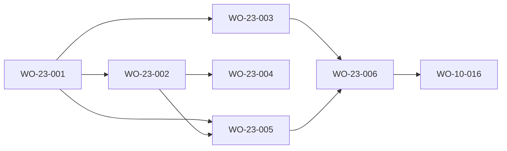

# Feature blueprint — FRD-23 Materialized stats read-model (v2 «Órbita» revision)

> **v2 revision (2026-10-22).** No behaviour of this feature changes in v2: the six work orders are VERIFIED history kept
> live, and the Informe keeps reading this read-model (Logros › Estadísticas, FRD-10 WO-10-017). This revision adds the
> component and interface ids, the requirement traceability, the Build Plan table, and narrows each work order's
> declared artifacts to the files it really wrote. AC-23-001.5 (the seal-coverage rule of 2026-09-30) was checked against
> the code: it is implemented and proven by
> `src/lib/achievements/read-model/_tests/informeResolver.sealCoverage.test.ts`, so no new work order is needed.

> **Source-of-truth hierarchy:** `FRD > FDD > design-tokens > blueprint > work order`.
> This is the **feature blueprint** (DR-049): how FRD-23 is implemented on top of the platform in
> [`docs/product/architecture.md`](../../product/architecture.md), and how it supersedes the FRD-10
> blueprint §3 "git-at-read-time in the render" contract for the Informe. Architecture decision:
> [ADR-0004](../../adr/ADR-0004-materialized-stats-read-model.md).

## 1. Summary

Move the Informe's history-derived numbers from "derive by shelling out to git in the render" to
"read a materialized read-model (`.pandacorp/stats.json`) with a self-validating freshness seal, and
fall back to the live git reader when the snapshot is missing / stale / corrupt". The **live git
readers stay** (WO-10-014, `src/lib/achievements/report/*`) — they become the **fallback**, not the
primary path, and the reference the writer + equivalence test derive against.

## 2. Platform references

- **Read-only invariant (architecture §7).** Mission Control (the app) stays **read-only** over the
  read-model: it only reads `stats.json` + the aggregate index + (fallback) live git. The **writers**
  live in the **factory tooling**, not in the MC app: the Stop hook / `post-commit` hook / `sync-portfolio`
  / the backfill command. This is a platform decision — see ADR-0004. MC's `lib/discard/` write set is
  unchanged; MC never writes `stats.json`.
- **Fail-loud read boundary (DR-078).** The portada reader and the aggregate reader parse-don't-validate:
  a typed value OR an explicit error variant, never a silent `[]`/`null`. The caller renders the
  fallback / error state.
- **Single source of truth (DR-115).** `stats.json` is an **honest cache**: single named writer,
  re-derived from git (the atomic source) at safe points, seal-validated on read, documented as a
  replica; never maintained by incremental writes; never read while a live resolver would be more
  correct (seal decides).
- **Reuse of existing readers.** The writer derives the portada by calling the already-shipped **pure**
  cores in `src/lib/achievements/report/*` (`deriveWeeklyFlow`, `derivePhaseTransitions`, `deriveScalars`,
  `deriveLessonCounts`, `funnelAndFlow`) — do NOT re-implement the derivation (DR-092).

## 3. Modules

- **`src/lib/achievements/read-model/statsReader.ts`** (new) — `readStatsPortada(projectPath): PortadaResult`
  and `readStatsAggregate(): AggregateResult`. Fail-loud (DR-078): parse the JSON with a Zod schema; on a
  malformed/unrecognised shape return an explicit error variant. `PortadaResult = {ok:true; value: StatsPortada}
  | {ok:false; reason:"missing"|"stale"|"unparseable"}`.
- **`src/lib/achievements/read-model/seal.ts`** (new) — `currentSeal(projectPath): string` =
  `git log -1 --format=%H -- docs/frds .pandacorp/status.yaml` (O(1)); `isFresh(portada, seal)`.
- **`src/lib/achievements/read-model/statsWriter.ts`** (new — factory tooling, invoked by hooks/backfill)
  — `writeStatsPortada(projectPath)`: re-derives via the report `derive*` cores + stamps the seal, writes
  **atomically** (tmp + rename). Single writer (DR-115).
- **Informe wiring** — the Informe data layer (WO-10-014 consumers) is changed to try the portada/aggregate
  first (via `statsReader`) and fall back to the existing live git readers on any non-`ok` result. The live
  readers are unchanged.
- **`sync-portfolio` join** — extend the existing portfolio walk to write the aggregate index from the N
  portadas.
- **Backfill** — one-shot command over existing projects calling `writeStatsPortada` once each.

## 3b. SSOT split — factory-wide store vs per-project portada (DR-115/DR-116)

The FRD-23 gate surfaced a DR-115 defect in the **original** contract: the per-project portada embedded
**factory-wide** facts (`phaseTransitions`, `scalars.projects`, `scalars.decisions`, `lessons`) that (a)
were written N times (once per portada) and (b) could not be validated by the per-project seal (a phase
change in project B leaves A's embedded copy stale but A's seal unchanged). The corrected design splits the
store by scope; the FRD §"Portada scope-split" is the contract, ADR-0004 §"SSOT correction" the decision.

- **`src/lib/achievements/read-model/factorySeal.ts`** (new) — `currentFactorySeal(factoryRoot): string | null`
  = the hash of the last commit touching `factory/portfolio.md`, `factory/decisions/`, `factory/memory/`
  and every project's `.pandacorp/status.yaml` (one `git log -1 --format=%H -- <those paths>`).
  `isFactoryFresh(store, seal)` — equality only (LESSON-0009: commit hashes, not timestamps → no ordering).
- **`src/lib/achievements/read-model/factoryStoreReader.ts`** (new) — `readStatsFactory(factoryRoot): FactoryResult`,
  fail-loud (DR-078), same discriminated-result convention as `readStatsPortada`.
- **`src/lib/achievements/read-model/factoryStoreWriter.ts`** (new — factory tooling) —
  `writeStatsFactory(factoryRoot)`: re-derives `phaseTransitions`/`scalars.projects`/`scalars.decisions`/
  `lessons` via the existing `derive*` cores, stamps the factory seal, atomic tmp+rename. **Single writer.**
- **Prune the per-project writer/reader/schema** so the portada holds only per-project facts.
- **Recompose the Informe reader** (`resolveInformeSources` / `resolvePortadaFromAggregate`) to merge the
  two stores, each with an **independent** fail-loud fallback to the live `derive*` cores.

## 4. Data model

```
// per-project — validated by the per-project seal (git log -1 -- docs/frds .pandacorp/status.yaml)
StatsPortada = {
  seal: string,
  generatedAt: string,        // ISO — provenance, not authority
  woFlow: WoVerifiedSeries,   // from report/types.ts: { woVerified, peakWeek } (the sealed half of WeeklyFlow)
  scalars: ProjectScalars,    // sealed subset: { frds }  (commits/funnel/ideas series are ALWAYS LIVE, AC-23-001.5)
}
StatsAggregate = { projects: Record<string, StatsPortada> }
PortadaResult   = { ok: true; value: StatsPortada } | { ok: false; reason: "missing" | "stale" | "unparseable" }

// factory-wide — validated by the factory seal (portfolio.md + decisions/ + memory/ + every status.yaml)
StatsFactory = {
  seal: string,
  generatedAt: string,
  phaseTransitions: PhaseTransition[],
  scalars: FactoryScalars,    // { projects, decisions }
  lessons: LessonCounts | null,
}
FactoryResult = { ok: true; value: StatsFactory } | { ok: false; reason: "missing" | "stale" | "unparseable" }
```

`ReportScalars` splits into `ProjectScalars` (`frds`) held per-project and `FactoryScalars`
(`projects`, `decisions`) held factory-wide; the Informe composes both back into the shape FRD-10 renders.
Neither reader returns a bare `[]`/`null` on an unrecognised shape (DR-078); `reason` distinguishes
"missing" / "unparseable" / "stale" so the caller acts correctly and per scope independently.

## 5. Testing (DR-078 / DR-115)

- **Real-shape fixture** portada (production shape) → reads correctly, seal matches → used.
- **Malformed** portada (bad JSON / wrong shape) → reader fails loud → fallback to live git.
- **Stale** portada (seal mismatch) → fallback.
- **Missing** portada → fallback.
- **Atomic write** → a simulated mid-write never leaves a readable corrupt file.
- **Equivalence** → materialized numbers == live-git numbers for the same project (cross-check the
  `ca82bbba` invariant).
- **Aggregate index** → O(1) read; malformed aggregate fails loud.
- **Backfill** → generates an initial portada equivalent to the live reader.

### SSOT-split tests (REQ-23-006/007)
- **Factory seal detects cross-project staleness (the regression)** → materialize A and B; a phase change
  in B mismatches the factory seal; A's Informe does NOT read stale factory-wide facts (AC-23-007.3). This
  is the exact defect the split fixes and must fail without the fix, pass with it.
- **Factory store fail-loud** → missing / stale / malformed factory store → explicit reason, never a
  fabricated zero (AC-23-006.3).
- **Independent fallback** → factory-seal mismatch falls back for factory-wide facts ONLY, per-project
  facts untouched, and vice-versa (AC-23-007.2).
- **Per-project portada validated by its own seal** → now that it holds only per-project facts, its seal
  covers 100% of its contents (AC-23-006.4).
- **Equivalence** → factory store numbers == live `derive*` numbers; per-project portada numbers == live.

### Seal-coverage tests (AC-23-001.5)
- **Unsealed facts stay live** → beside a fresh portada the resolver reads `commits`, `funnel` and the ideas-per-week series from the live readers and serves only the WO-verified series and the FRD count from the portada; an un-derivable live ideas series fails loud, never a fabricated empty series (`informeResolver.sealCoverage.test.ts`, owned by WO-23-006).

## 6. Components and interfaces (ids for traceability)

All under `src/lib/achievements/read-model/` (a pure `lib` package; no UI, no route, no API contract: DR-060 does not apply).

- **`IF-23-portada-reader`** — `statsSchema.ts`, `seal.ts`, `statsReader.ts`: `parseStatsPortada` / `parseStatsAggregate`, `currentSeal`, `isFresh`, `readStatsPortada`, `readStatsAggregate`. Fail-loud results `missing | stale | unparseable`. → REQ-23-001, REQ-23-003 (aggregate reader fail-loud).
- **`IF-23-portada-writer`** — `statsWriter.ts`: `buildPortada`, `gatherLiveValues`, `writePortadaAtomic`, `writeStatsPortada` (single writer, tmp + rename, assembled from the report `derive*` cores). → REQ-23-002.
- **`IF-23-aggregate`** — `aggregate.ts`, `aggregateConsumer.ts`: the O(1) join and its read path with the per-use seal re-check. → REQ-23-003.
- **`IF-23-regen-backfill`** — `regen.ts`, `backfill.ts`, `scripts/read-model/**`: the commit-driven regeneration point and the one-shot backfill. Factory tooling; Mission Control never writes the stores. → REQ-23-003, REQ-23-004.
- **`IF-23-factory-store`** — `factorySeal.ts`, `factoryStoreReader.ts`, `factoryStoreWriter.ts`: the factory-scoped store, its factory-wide seal, reader and single writer. → REQ-23-006.
- **`CMP-23-informe-resolver`** — `informeResolver.ts` (+ the seam in `src/app/achievements/page.tsx`): composes the per-project and factory-wide stores with an independent fail-loud fallback per scope, and keeps the unsealed facts live. → REQ-23-001 (incl. AC-23-001.5), REQ-23-005 (nothing here touches `getPendingMerge`), REQ-23-007.

## 7. Traceability (REQ → CMP / IF → work order)

| Requirement | Component(s) / interface(s) | Work order |
|---|---|---|
| REQ-23-001 portada reader, fail-loud, fallback (AC-23-001.1 to .4) | `IF-23-portada-reader` | WO-23-001 |
| REQ-23-001 seal coverage (AC-23-001.5) | `CMP-23-informe-resolver` | WO-23-006 (proof: `informeResolver.sealCoverage.test.ts`) |
| REQ-23-002 portada writer, atomic, equivalence | `IF-23-portada-writer` | WO-23-002 |
| REQ-23-003 aggregate index, fail-loud reader | `IF-23-aggregate`, `IF-23-portada-reader` | WO-23-004 |
| REQ-23-004 backfill | `IF-23-regen-backfill` | WO-23-004 |
| REQ-23-005 pending merge stays live | none (`getPendingMerge` is untouched; guarded at the resolver seam) | WO-23-003 |
| REQ-23-006 factory-scoped store | `IF-23-factory-store` | WO-23-005 |
| REQ-23-007 composed reader | `CMP-23-informe-resolver` | WO-23-006 |

Every live AC (19) is owned by exactly one work order: AC-23-001.1 to .4 by WO-23-001; AC-23-001.5 and AC-23-007.1 to .3 by WO-23-006; AC-23-002.1 to .3 by WO-23-002; AC-23-003.1, .2 and AC-23-004.1 by WO-23-004; AC-23-005.1 by WO-23-003; AC-23-006.1 to .4 by WO-23-005.

## Build Plan

> The build engine reads this table; it does not infer dependencies. All six work orders are VERIFIED history kept live; their declared artifacts are narrowed to the exact files each wrote so the plan is verifiably disjoint inside every wave (the earlier `read-model/**` and `src/app/**` catch-alls are gone).

| WO | Depends on | Artifacts (globs) | Foundation | Parallel with |
|---|---|---|---|---|
| WO-23-001 | — | `src/lib/achievements/read-model/statsSchema.ts`, `src/lib/achievements/read-model/seal.ts`, `src/lib/achievements/read-model/statsReader.ts`, `src/lib/achievements/read-model/_tests/statsSchema.test.ts`, `src/lib/achievements/read-model/_tests/statsReader.test.ts`, `src/lib/achievements/read-model/_tests/seal.test.ts`, `src/lib/achievements/read-model/_tests/fixtures.ts` | false | W0 |
| WO-23-002 | WO-23-001 | `src/lib/achievements/read-model/statsWriter.ts`, `src/lib/achievements/read-model/_tests/statsWriter.test.ts` | false | W1 (with WO-23-003) |
| WO-23-003 | WO-23-001 | `src/lib/achievements/read-model/informeResolver.ts`, `src/lib/achievements/read-model/_tests/informeResolver.test.ts`, `src/app/achievements/page.tsx` | false | W1 (with WO-23-002) |
| WO-23-004 | WO-23-002 | `src/lib/achievements/read-model/aggregate.ts`, `src/lib/achievements/read-model/aggregateConsumer.ts`, `src/lib/achievements/read-model/backfill.ts`, `src/lib/achievements/read-model/regen.ts`, `src/lib/achievements/read-model/_tests/aggregate.test.ts`, `src/lib/achievements/read-model/_tests/aggregateConsumer.test.ts`, `src/lib/achievements/read-model/_tests/backfill.test.ts`, `src/lib/achievements/read-model/_tests/regen.test.ts`, `src/app/achievements/page.tsx`, `scripts/read-model/**`, `vitest.config.ts` | false | W2 (with WO-23-005) |
| WO-23-005 | WO-23-001, WO-23-002 | `src/lib/achievements/read-model/factorySeal.ts`, `src/lib/achievements/read-model/factoryStoreReader.ts`, `src/lib/achievements/read-model/factoryStoreWriter.ts`, `src/lib/achievements/read-model/statsSchema.ts`, `src/lib/achievements/read-model/statsWriter.ts`, `src/lib/achievements/read-model/informeResolver.ts`, `src/lib/achievements/read-model/_tests/factorySeal.test.ts`, `src/lib/achievements/read-model/_tests/factoryStoreReader.test.ts`, `src/lib/achievements/read-model/_tests/factoryStoreWriter.test.ts`, `src/lib/achievements/read-model/_tests/factorySchema.test.ts`, `src/lib/achievements/read-model/_tests/gitFixture.ts`, `src/lib/achievements/read-model/_tests/fixtures.ts`, `src/lib/achievements/read-model/_tests/statsSchema.test.ts`, `src/lib/achievements/read-model/_tests/statsWriter.test.ts`, `src/lib/achievements/read-model/_tests/informeResolver.test.ts` | false | W2 (with WO-23-004) |
| WO-23-006 | WO-23-003, WO-23-005 | `src/lib/achievements/read-model/informeResolver.ts`, `src/lib/achievements/read-model/_tests/informeResolver.test.ts`, `src/lib/achievements/read-model/_tests/informeResolver.sealCoverage.test.ts`, `src/app/achievements/page.tsx` | false | W3 |

- **Order and parallelism.** WO-23-001 first; WO-23-002 and WO-23-003 are siblings (W1); WO-23-004 and WO-23-005 are siblings (W2); WO-23-006 composes the two (W3). The v1 files each one rewrites (`statsSchema.ts`, `statsWriter.ts`, `informeResolver.ts`, `page.tsx`) are shared only across different waves.
- **Cross-FRD dependencies.** Consumes FRD-10 WO-10-014's report `derive*` cores (VERIFIED history, not a dependency edge: they are imported, not edited). Consumers: FRD-10 WO-10-016 (waits for WO-23-006 because both write `src/app/achievements/page.tsx`; it is a later wave, W4), FRD-10 WO-10-017 (reads the composed sources through `loadStatisticsData`), FRD-01 WO-01-011 (adopts the clock and git seams in these readers, W5, after this FRD's last wave).
- **Visual spec.** None: this FRD has no UI and changes no visual (no design pass needed).



## Superseded (v1 history)

None: all six work orders stay live as history.

## Readiness check (DR-100)

Every `REQ-23-001` to `REQ-23-007` maps to a component or interface above; every live AC (19) is covered by exactly one work order; `dependsOn` is acyclic and every referenced work order exists; wave-parallel work orders have disjoint artifacts by design; no foundation work is needed (a pure `lib` package); the platform data model is unchanged (the stores are runtime caches, not entities); no unresolved clarification marker survives in this feature's documents. Lessons that shaped it: LESSON-0009 (seals are commit hashes compared for equality, never ordered), LESSON-0113 (a documented trigger is a proposal until its call site exists: the seal-coverage test names its file).
