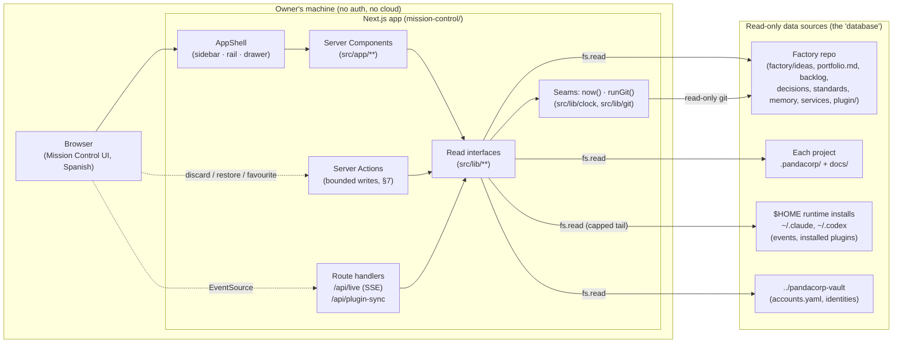

# Platform architecture — Pandacorp Mission Control

> **Source-of-truth hierarchy:** `FRD > FDD > design-tokens > blueprint > work order`.
> This document is the **platform architecture** (DR-049): the one stable, project-wide
> technical foundation. It describes the chosen stack, the high-level architecture, the
> "data model" (the factory filesystem MC reads), the read interfaces, the route map, the
> environment contract, cross-cutting concerns, the testing strategy and the deploy posture. It does
> **not** describe how each feature is implemented; that lives per-FRD in
> `docs/frds/frd-NN-<slug>/blueprint.md`, which references this file rather than restating it.
>
> **Version 2 «Órbita» (2026-10-22).** Revised for milestone v2: the frozen Órbita design contract
> ([ADR-0012](../adr/ADR-0012-adopt-orbita-design-system.md)) replaces the Atelier / pixel-RPG skin, the
> top navigation, the portfolio rail and the Party tab. The stack does not change. v2 builds what the
> frozen design and the amended FRDs state and **removes** the v1 features the design dropped
> (decision log 2026-10-22, "v2 may remove v1 features"); the removal list and the removing work orders
> are in the v2 work-order map.

---

## 1. What Mission Control is (and the one rule that shapes everything)

Mission Control is a **local, read-only dashboard** to operate the Pandacorp factory: see the
state of ideas and projects, read their documentation, know the next command to copy, and watch
builds progress live in La Fragua, wrapped in an honest guild layer (ranks, trophies, La Campaña).

The single golden rule that drives every architectural choice: **Mission Control NEVER calls
Claude and NEVER executes anything.** It only *reads files* from the factory repo, its projects and
the user's runtime installs, and renders text plus a "next command" to copy. The only writes are a
small, bounded, human-triggered set of Server Actions, each rewriting one frontmatter field of one
file (or one owned ledger), listed in §7 "Read-only invariant". They are human decisions, not build steps.

Consequences that ripple through the whole architecture:
- No AI SDK, no API key, no subprocess that runs Claude, no "thinking" spinners.
- The factory repo **is the database** (read-only): no DB, no ORM, no migrations.
- Local only: no auth, no cloud deploy, no multi-tenant concerns (§10 records where it listens).

---

## 2. Chosen stack (golden path A, trimmed) — approved by the owner

Golden path **A (Next.js)** from `factory/standards/stack.md`, deliberately **trimmed** for an
internal read-only tool. The justification and the discarded alternatives are recorded in
**[ADR-0001](../adr/ADR-0001-stack.md)**. **v2 changes no stack choice**; it changes the visual
layer on top of it (ADR-0012), adds a typed copy accessor (ADR-0013) and retires one dependency (Dagre).

| Layer | Choice | Why (trimmed rationale) |
|---|---|---|
| Framework | **Next.js** (App Router) | Server Components read the filesystem on the server; zero client data-fetching plumbing. |
| Language | **TypeScript** `strict` + `noUncheckedIndexedAccess` | Factory durable convention (no `any`, no `@ts-ignore`). Pinned <6.0, see ADR-0001. |
| UI runtime | **React 19** | Bundled with Next 16. |
| Styling | **Tailwind CSS v4** (CSS-first `@theme`) | The `@theme` block mirrors the frozen Órbita `docs/design/design-tokens.json` (light + dark). No `tailwind.config.js`. |
| Fonts | Three **self-hosted** families (Space Grotesk, Inter, JetBrains Mono) via the prototype's exact `@font-face` rules | Fidelity gate needs string-exact families; `next/font` and Pixelify Sans are retired (ADR-0012, technical-assumptions §1.1). |
| Icons | The **64 exported SVGs** behind one `Icon` component | No icon library and no icon CDN; the v1 Tabler CDN link is removed in v2. |
| Copy | Typed accessor `t(key, vars?)` in `src/lib/copy/` over the frozen `docs/design/microcopy.es.json` | Single-locale Spanish UI; no `next-intl` (ADR-0013). |
| Lint + format | **Biome** | One fast tool; replaces ESLint+Prettier. Gate #1. |
| Tests | **Vitest** + `@testing-library/react` + `jsdom`; **Playwright** + `@axe-core/playwright` for the browser gates | TDD in `lib/`; component tests; e2e/fidelity gates (§9). |
| Frontmatter / YAML / Markdown | `gray-matter`, `yaml`, `react-markdown` + `remark-gfm` | Idea cards, `status.yaml`/registry, document rendering. |
| Graph layout | **ELK** (`elkjs`, exact-pinned) for logical data models only | Off-thread layered orthogonal layout (ADR-0007). The dependency map uses the prototype's own placement code ported as a pure, deterministic layout (`src/lib/deps-layout/`), no graph library. **Dagre is removed in v2** (`pnpm remove @dagrejs/dagre`, WO-13-013). |

**Package manager:** `pnpm` (pinned through `packageManager`). **Node:** ≥ 20.9 (Next 16 minimum).

### Pinned versions

The lockfile (`pnpm-lock.yaml`) is the authority; these are the installed versions observed on
2026-10-22. v2 installs nothing.

| Package | Installed | Manifest range |
|---|---|---|
| `next` | 16.2.9 | `^16.2.7` |
| `react` / `react-dom` | 19.2.7 | `^19.2.7` |
| `tailwindcss` | 4.3.1 | `^4.1.13` |
| `typescript` | 5.9.3 | `^5.9.3` |
| `vitest` | 4.1.9 | `^4.1.9` |
| `@biomejs/biome` | 2.5.2 | `^2.5.2` |
| `@playwright/test` | 1.61.0 | `^1.61.0` |
| `elkjs` | 0.12.0 | `0.12.0` |
| `@dagrejs/dagre` | installed today | `^3.0.0`, removed by WO-13-013 |
| `pnpm` | 10.12.1 | `packageManager` |

### Deliberately EXCLUDED from the trim (and why)
- **No database / Prisma / Drizzle**: the factory repo is the read-only data source.
- **No auth**: single local operator.
- **No Docker / no t3-app generator**: an internal local tool.
- **No Claude SDK / no subprocess execution**: the golden rule (§1).
- **No external services** (payments, storage, email, analytics, error tracking): nothing leaves the
  machine. See "Explicit scope decisions" below. `factory/standards/external-services.md` has no
  service to govern here; MC reads the factory's service catalog and accounts only to *display* them (FRD-26).
- **No graph, animation, icon or font-loader library**: the frozen design forbids them (technical-assumptions §1, §3).

---

## 3. High-level architecture



**Rendering model.** **Server Components** are the default and do all filesystem reads through
`src/lib/**`. Client Components (`"use client"`) are added only where interaction demands it: copy
buttons, the bounded write actions, dialogs, the sidebar collapse/float and the theme button, the
drawer, tab bars and segmented controls that write the URL, the live-refresh subscribers
(`/api/live`), the data-model viewer and the dependency-map chain highlight. Everything that can be a
Server Component is one. No global client state library (`react.md`).

**Why filesystem reads belong on the server.** Reading `factory/`, the vault and `$HOME` is
privileged local I/O; it never reaches the client. All `fs`/`git` access stays server-side and the
browser only receives shaped, serializable data. Components, pages, panels and Server Actions never
touch `fs` or git directly (structure guard).

**Refresh.** Every route renders per request (`dynamic = "force-dynamic"` on the root layout). Live
surfaces subscribe to `/api/live`, which streams event deltas and the project `stateVersion`; event
tails are **capped** so long builds don't degrade the render. File-watching beyond that is not planned.

---

## 4. Data model — the factory filesystem (the read-only "database")

There is no schema in a DB; the schema is the **shape of the files MC reads**. This section is the
complete inventory. Path constants live in `src/lib/config/config.ts` (override the root with
`PANDACORP_FACTORY_ROOT`; default = one level up from `process.cwd()`, because MC lives inside the
factory repo). **v2 changes no logical shape**: `docs/product/data-model.json` stays
`persistence: none` (§4.9), and every v2 change is presentation, URL state or a new derivation over
these same files.

### 4.1 Idea cards — `factory/ideas/*.md` (skip `_idea-template.md`, `decision-log.md`)
Markdown with YAML frontmatter (parsed by `gray-matter`). Fields read (FRD-01/02):

| Field | Type | Notes |
|---|---|---|
| `title` | string | Card title. |
| `status` | enum | `discovered \| recommended \| in-pipeline \| shipped \| discarded`. Written only by discard/restore (FRD-02, ADR-0002). Once `in-pipeline` the card freezes as a pointer. |
| `discard_reason`, `status_before_discard` | string | Discard bookkeeping written with `status: discarded`, cleared by restore. |
| `favorite` | bool | Optional visual flag (FRD-02 REQ-02-012, ADR-0003). Never affects status or column. |
| `project_type` | enum | Category chip + board filter. |
| `return_type` | enum | `monetary \| opportunity \| personal \| mixed`. |
| `score` | number | Priority score. |
| `project` | string | Pointer to the project once in-pipeline. |
| (body) | markdown | Rendered in the idea page (Propuesta, Documentos). |

### 4.2 Owner profile — `factory/profile.md`
Its **absence** triggers the onboarding gate (FRD-01); when present, fields personalize views.

### 4.3 Portfolio — `factory/portfolio.md`
A table of created projects; each row yields a **project path** and optional `repo:` URL. For each
path MC reads that project's state and docs. Project ordering in v2 is by **last commit**, read
through the git runner (§7 fixture seams).

### 4.4 Per-project state — `<projectPath>/.pandacorp/status.yaml`
Machine state (English), parsed by `yaml`. Fields read: `project`, `phase` (`product | design |
architecture | implementation | release`, DR-085), `version`, `running`, `rethink_pending`,
`advance_pending`, `last_green_sha`, `safe_to_test`, `overlay_version`, `created_with`, `updated_at`.
**Single source of truth (DR-092/DR-115):** work-order counts are derived live from the work-order
files (`listWorkOrders`/`aggregateProgress`); `pending_decisions`/`pending_bugs` are overridden with a
live inbox count. The `progress`/`work_orders_total`/`work_orders_done` fields have **no reader**.
Absent/malformed renders partial, never breaks. `phase` is the single source of truth for the board
column of in-pipeline cards.

### 4.5 Per-project docs and queues — `<projectPath>/docs/` and `.pandacorp/`
- Product layer: `docs/product/{prd.md, research.md, architecture.md, data-model.json}`.
- Per-feature module: `docs/frds/frd-NN-<slug>/{frd.md, fdd.md?, blueprint.md?, mocks/?, work-orders/?}`
  (work-order frontmatter: `implementation_status`, `dependsOn`, `artifacts`, drift fields).
- Global: `docs/adr/*.md`, `docs/analytics/`, `docs/decision-log.md`, `.env.example` (variable names
  and their section comments, for Arquitectura › Variables de entorno; never values).
- Owner-facing layer (Spanish, gitignored): `.pandacorp/comms/{progress.md, spec-resumen.md}`,
  `.pandacorp/inbox/decisions.md` (a decision resolved inside its own entry is never pending, WO-04-013),
  `.pandacorp/inbox/bugs/`, `.pandacorp/inbox/changes/*.md` (the change queue, FRD-04).
- Integration links: `.pandacorp/accounts/services.yaml` (FRD-26).
- Materialized stats portada: `.pandacorp/stats.json` (FRD-23, ADR-0004).

### 4.6 Factory configuration, memory and queues (read-only)
- `factory/decisions/registry.yaml`, `factory/standards/*.md`: FRD-07.
- `factory/memory/*.md` (lessons, promotion state): FRD-17.
- `factory/backlog/BL-*.md` (factory backlog): FRD-22.
- `factory/services/catalog.yaml` (public service catalog): FRD-26.
- `factory/gamification-ledger.json` (durable guild facts, ADR-0005): FRD-09/10.
- `factory/navigation-identities.json` (owner-private identity catalog; written only by its CLI, ADR-0010): FRD-25.
- `<factory-root>/.pandacorp/stats-factory.json` (factory-scoped stats store, ADR-0004): FRD-10/23.
- `plugin/skills/<slug>/SKILL.md`, `plugin/agents/*.md`, `plugin/.claude-plugin/plugin.json`,
  `plugin/runtime/event-vocabulary.json` (projected into `src/lib/events/event-contract.ts`): FRD-07/08/15, ADR-0005.

### 4.7 Runtime installs under `$HOME` and the vault
- `~/.claude/dashboard-events.ndjson` and `~/.codex/dashboard-events.ndjson`: the **event streams**
  (La Fragua FRD-06, observability FRD-12, Inicio FRD-18), dual-read and deduplicated (ADR-0005), read as
  a capped tail. Contract in §5.
- `~/.claude/tasks/<team>/`: task state (absence tolerated).
- `~/.claude/plugins/installed_plugins.json` and the Codex plugin cache: installed plugin version for
  the FRD-15 drift check (semver compare against `plugin/.claude-plugin/plugin.json`; no git).
- `../pandacorp-vault/services/accounts.yaml`: private account identities, never secret values (FRD-26, ADR-0011).

### 4.8 Browser-local UI state (NOT a factory or project write)
`localStorage` preferences, consistent with the read-only constraint: sidebar collapsed, projects
group folded, board «Ocultar columnas vacías», theme choice, achievement notice shown-once, build mode
per project. v1's `visto_hasta` digest marker is removed in v2 with the digest.

### 4.9 Designed logical model — `<projectPath>/docs/product/data-model.json`

This artifact describes a monitored project's designed persistence model; it does not turn MC's
filesystem inventory into a database schema. **MC itself has no database**: its own artifact declares
`schemaVersion: 1`, `persistence: none`, empty `entities` and empty `relationships`, unchanged in v2.

The version-1 contract is [ADR-0006](../adr/ADR-0006-shared-logical-data-model-viewer.md): relational /
document / none persistence, stable entities with ordered attributes (logical type, optionality,
PK/FK/UQ), composite PK/UQ groups, relationships with explicit endpoint references and `min`/`max`.
Validation rejects invalid, unknown, oversized, dangling or duplicate input and never infers links from
names. The server reads at most 1 MiB and returns distinct ready / none / missing / error states. No
project code is executed.

The idea page and both workspace contexts read one bundle (`readArchitectureArtifacts`) and render the
same `ArchitectureDigest`, whose **Modelo de datos** band hosts the shared `DataModelViewer`
(native DOM/SVG + off-thread ELK layout; **Diagrama** and **Esquema**; phones open on Esquema). v2
restyles it to Órbita, compares the canvas by computed styles only, and removes the composite /
isolated / self-relation visual distinction, link attribute mappings, per-connector selection and the
viewport-filling fullscreen fallback (FRD-02 v2). The viewer always states designed-model provenance
(«Modelo diseñado, no verificado contra una base viva»).

---

## 5. Build-event contract (La Fragua and observability)

The producers (factory hooks and runtime emitters) and the consumer (Mission Control) share a
**portable** NDJSON contract. One JSON object per line. MC only consumes it. The semantic vocabulary
is authored once in `plugin/runtime/event-vocabulary.json` and projected into
`src/lib/events/event-contract.ts`; a drift gate compares the projection (ADR-0005).

**Fields read per event:** the event name (normalized through the vocabulary), `at` (ISO 8601; compared
with `Date.parse`, never lexicographically), `agent`/`session`, `tool`, `status` (`ok | fail`),
`work_order`/`task`, and `project` (the project slug; **events without `project` are legacy/global**).
The Codex stream adds `runtime`, `run_id`, `event_id`, `subject`; dedup is by `event_id`.

**What events drive in v2.** Events are a liveness and activity signal, never a source of phase or
work-order state (ADR-0005, DR-115). La Fragua places work-order tokens in its four stations
(Cola · Taller · Revisión · Bóveda) from the **work-order frontmatter state**; events only decide
whether the build is live («Construyendo ahora» / «En pausa» / «Sin señal», one resolver with a stale
label), animate crews and the courier while live, and feed the project-scoped activity tail.
FRD-level events never become tokens. The v1 Party state machine (walk/idle/review sprites) is removed.

---

## 6. Read interfaces (`src/lib/**`) — the data layer boundary

All filesystem, git and parse access is isolated in `src/lib/<domain>/`. Readers are pure where
possible, **fail loud** (DR-078: a typed result or an explicit error, never a silent `[]`), and shared
derived values are computed by **one resolver**, deduped per request with `React.cache()` (DR-115).
One owning work order per file per wave.

| Module (`src/lib/…`) | Responsibility | Owning FRD(s) |
|---|---|---|
| `config/` | Path constants + `resolveFactoryRoot` (env override / cwd `..`) + project path resolution. | FRD-01 |
| `clock/` (v2) | `now()`: the only source of "now" for readers; honours `MC_CLOCK`. | FRD-01 (WO-01-010) |
| `git/` (v2) | `runGit(args, cwd)`: the only git boundary; read-only commands; answers from a fixture when `MC_GIT_FIXTURE` is set. | FRD-01 (WO-01-010) |
| `copy/` (v2) | `t(key, vars?)` over `docs/design/microcopy.es.json` (ADR-0013). | FRD-13 (WO-13-010) |
| `theme/` (v2) | Theme preference (system default, remembered choice) and the no-flash boot contract. | FRD-13, FRD-19 |
| `ideas/`, `board/`, `campaign/`, `pitch/`, `next-step/` | Idea cards, board columns from status + phase, campaign facts, pitch, next command. | FRD-01, FRD-02 |
| `profile/`, `portfolio/`, `status/`, `fs-utils/` | Profile/onboarding, portfolio table, `status.yaml` + liveness + `stateVersion`, small fs probes. | FRD-01, FRD-03 |
| `portfolio/` (v2 addition) | Last-commit-ordered project list (through `runGit`). | FRD-03 |
| `docs/`, `spec/`, `architecture/`, `frds/` | Per-project doc tree, Spec digest, Architecture bundle (digest, model, env, ADRs), FRD drift. | FRD-02, FRD-04, FRD-05 |
| `work-orders/`, `build-track/`, `deps-layout/` (v2) | Work-order reads and progress; build track; deterministic dependency-map layout. | FRD-05, FRD-12 |
| `events/`, `tasks/`, `fragua/` (v2) | Event tails (dual-read, capped), task state, La Fragua station derivation. | FRD-06, FRD-12 |
| `changes/`, `backlog/` | Change queue and factory backlog readers (+ their discard writes). | FRD-04, FRD-22 |
| `memory/`, `self-suggest/`, `proposals/` | Lessons, automatic signals, `ownerActions()` (Propuestas list and sidebar badge). | FRD-17 |
| `inicio/` (v2) | `ownerTurnItems()` (Tu turno and its count). | FRD-18 |
| `pendingMerge/` | `getWorktreesByRepo()` + `pendingPillSummary()` (v2), legacy `getPendingMerge()` until unreferenced. | FRD-21 |
| `snapshot/`, `overlay-freshness/`, `plugin-sync/` | Last green commit panel, overlay freshness, plugin drift. | FRD-14, FRD-20, FRD-15 |
| `registry/`, `standards/`, `reference/`, `manual/` | Decision rules, standards, skills/agents reference, Documentación content index. | FRD-07, FRD-08 |
| `gamification/`, `achievements/` | Guild state and ledger (ADR-0005), achievements, stats read-model (ADR-0004). | FRD-09, FRD-10, FRD-23 |
| `services/` | Join of service catalog, vault identities and project links (whitelisted DTO). | FRD-26 |
| `navigation/` | The single URL codec + identity catalog reader (ADR-0010). | FRD-25 |
| `discard/`, `favorite/` (writes) | Idea discard/restore and favourite writes. | FRD-02 (ADR-0002, ADR-0003) |

---

## 7. Cross-cutting concerns

- **Read-only invariant.** The complete write set, each a human-triggered Server Action that rewrites
  one frontmatter field of one file and preserves everything else verbatim:
  1. idea discard / restore, `status` (+ discard bookkeeping): `src/lib/discard/` (FRD-02, ADR-0002);
  2. idea favourite, `favorite`: `src/lib/favorite/` (FRD-02, ADR-0003);
  3. change-queue discard, `status: discarded`: `src/lib/changes/discard-change.ts` (FRD-04);
  4. backlog item discard, `status: discarded`: `src/lib/backlog/discard-backlog.ts` (FRD-22);
  5. the guild ledger `factory/gamification-ledger.json`, sole writer `src/app/_actions/snapshotLedger.ts`,
     oracle-corroborated (ADR-0005).
  v2 adds no write. The stats read-model (ADR-0004) and the identity catalog (ADR-0010) are written by
  CLI scripts at safe points, never by a page render. No Claude/AI client exists in `package.json`.
  Git is read-only (`runGit` only issues read commands).
- **Security / data minimization.** No auth (single local operator). No secrets: MC has no external
  service and needs no secret value; `.env.example` lists only path overrides. MC reads owner data
  already in the local repo and vault (profile, gitignored comms, account identities) and never
  transmits it; there is no outbound network call. Account identities cross the server/client boundary
  only through the whitelisted FRD-26 DTO. Rate limiting is N/A (no public endpoint). The always-on
  snapshot's LAN binding is an owner override (§10).
- **i18n and copy (Spanish interface; shown content keeps its language).** Every string Mission Control
  itself says (navigation, headings, labels, states, empty states, buttons, `aria-label`s, dialog
  kickers) comes from the frozen catalogue `docs/design/microcopy.es.json` through the typed accessor
  `t(key, vars?)` in `src/lib/copy/` ([ADR-0013](../adr/ADR-0013-typed-copy-accessor.md)). The catalogue is
  frozen design contract: implementers never edit it, and a string it lacks is a design defect reported
  to the ledger (DR-130), never an ad-hoc literal. Content MC only **shows** (project documents, FRD and
  work-order bodies, skill and agent descriptions, rules, lessons, backlog items) is rendered in its
  original language and never translated. Artifact names stay English inside Spanish sentences (FRD,
  PRD, ADR, work order, spec, backlog). `<html lang="es">`. Code, identifiers and committed docs are English.
- **Visual system (FRD-13, ADR-0012).** Órbita tokens only (the `@theme` mirror of `design-tokens.json`;
  no arbitrary values, no literal colours, radius/shadow from tokens); light and dark both first-class
  via `[data-theme]` with a `prefers-color-scheme` default, a no-flash boot script and the sun/moon
  button (the v1 high-contrast option is removed, map §6.A O1 default); `--scene-*`/`--map-*` surfaces
  always dark; status hues (green/amber/coral) for status only; never state by colour alone; nothing
  below 12 px; `tabular-nums` on numbers; mono only for ids, code, commands and paths.
- **Shell and layout (FRD-19).** One `AppShell` mounted in the root layout on **every** route (no
  exempt route): 252 px sidebar collapsible to a 64 px rail (≥ 1180 px), 76 px tablet rail
  (760–1179 px), phone top bar + bottom nav + off-canvas drawer (< 760 px), skip link first, content
  frame **1180 px** centred with 40/24/16 px gutters. Seven destinations: Inicio, Tablero, Portafolio,
  Propuestas, Logros, Documentación, Configuración. The v1 top bar, its exemptions and the 1240 px frame
  are gone.
- **Motion and accessibility.** WCAG 2.2 AA in both themes; transform/opacity-only motion under 300 ms;
  `prefers-reduced-motion` switches animation off; hover rules only inside `@media (hover: hover)`;
  `scroll-padding` keeps focus clear of sticky bars; native `<dialog>` with focus return; 44 px design
  target.
- **URL as state (FRD-25, ADR-0010).** Every shareable selection lives in the URL through the single
  codec in `src/lib/navigation/`; search typing replaces history; no URL write ever runs a mutation.
  The full family list is the Route map below.
- **Fixture seams (oracle mode, ADR-0012).** The fidelity gate replays 159 oracle states against a
  fictional fixture factory, so every reader resolves its inputs through injectable seams: the factory
  root, `HOME`, the two event files, the accounts file, the clock (`now()` honouring `MC_CLOCK`) and git
  (`runGit()` answering from the fixture's `git-state.json` when `MC_GIT_FIXTURE` is set). Each seam is
  **inert unless its variable is set**: `pnpm dev`/`pnpm start` never set them, and only `pnpm dev:oracle`
  (WO-01-010) and the test/e2e harness do. Oracle mode never reads the owner's real factory. A read error
  state is produced by pointing a reader at a malformed fixture, never by mocking the reader. Because
  `config.ts` resolves some paths at import time, the variables must be set before the server starts.
  The harness also forces its own default root to be catalog-absent, so owner-private files never leak
  into tests (LESSON-0450).
- **Error / empty / loading states.** Every reader distinguishes empty from unreadable; every surface
  draws both (the frozen design captures the read-error states). The global error net
  (`global-error.tsx`, `error.tsx`, `not-found.tsx`) exists.
- **Materialized read-model for git-derived stats (FRD-23, ADR-0004).** Readers that would shell out to
  git on every request read a sealed, honest cache (per-project `stats.json`, factory-scoped
  `stats-factory.json`); any seal mismatch falls back to the live readers verbatim (fail-loud), never a
  fabricated zero. Written once at a safe point by its CLI, never incrementally.

### Environment variables

Every variable is optional; with none set, MC reads the real factory one level up. v2 adds the two
clock/git seam variables (WO-01-010, which also owns `.env.example` and the README env section; each
variable gets its own comment line, CONV-16).

| Variable | Purpose | Default when unset | Who sets it | In `.env.example` |
|---|---|---|---|---|
| `PANDACORP_FACTORY_ROOT` | Factory repo root every reader resolves from. | `process.cwd()/..` | tests, e2e, `dev:oracle` (fixture factory root) | yes |
| `HOME` (`USERPROFILE` fallback) | Locates `~/.claude` and `~/.codex` (events, installed plugins). | the OS user home | `dev:oracle` (fixture home) | no (OS variable) |
| `PANDACORP_EVENTS_FILE` | Claude event stream path. | `~/.claude/dashboard-events.ndjson` | e2e (`e2e/server-env.json`), `dev:oracle` | yes |
| `PANDACORP_CODEX_EVENTS_FILE` | Codex event stream path. | `~/.codex/dashboard-events.ndjson` | `dev:oracle` | pending (WO-01-010) |
| `PANDACORP_ACCOUNTS_FILE` | Private account registry (identities, never secrets). | `<factory-root>/../pandacorp-vault/services/accounts.yaml` | `dev:oracle` | yes |
| `PANDACORP_CODEX_PLUGIN_ROOT` | Authoritative Codex plugin activation pointer for the drift check. | Codex cache probe | owner, when Codex uses a non-standard install | pending (WO-01-010) |
| `PANDACORP_STALE_HOURS` | Hours of inactivity after which unmerged work is flagged stale. | `3` | owner | pending (WO-01-010) |
| `MC_CLOCK` (v2) | Frozen ISO-8601 instant returned by `now()`. | real clock | `dev:oracle` (`2026-10-21T00:20:00.000Z`), tests | pending (WO-01-010) |
| `MC_GIT_FIXTURE` (v2) | Path to a `git-state.json`; when set, `runGit()` answers from it and never spawns git. | real read-only git | `dev:oracle`, tests | pending (WO-01-010) |

`NODE_ENV` is the framework's own. The prototype exporters (`docs/design/prototype/scripts/`) also
use `MC_REAL`, `GIT_DIR` and `GIT_CEILING_DIRECTORIES`; those belong to the design tooling, not the app.
MC has no secrets, so the three-file environment handoff of `external-services.md` reduces to the
tracked, placeholder-only `.env.example`; there is no production secret file.

### Explicit scope decisions

Recorded for this internal, personal-return tool (DR-131 asks each one separately).

| Scope | Answer | Source |
|---|---|---|
| PostHog / product analytics | **Excluded.** No SDK, no event plan; the economic arc does not apply (`return_type: personal`). | `docs/analytics/events.md` (verification 2026-07-05), CLAUDE.md |
| Sentry / error tracking | **Excluded.** No SDK; unexpected errors surface through the global error net and the dev/server logs. | Decision log (overlay re-sync: "mission-control has no PostHog/Sentry"); no explicit owner quote recorded |
| Multilingual i18n | **Single locale, Spanish.** No locale routing, no switcher, no `hreflang`; centralized catalogue via `t()`. Shown content keeps its language. | Owner decision 2026-10-21 (interface language), ADR-0012 §2, PRD v2 constraints |
| SEO / metadata | **Excluded.** Basic page identity only (the app name as the browser-tab title); no OG, sitemap, robots or structured data. | Evident for a non-public internal tool (`seo-i18n.md`); no explicit owner answer recorded |
| Mailing list | **Excluded.** No list, no Kit, no email of any kind. | Evident (no external services, §2); no explicit owner answer recorded |

---

## 8. Service boundaries / module structure

```
mission-control/
  src/
    app/                    # App Router: pages, layouts, Server Actions, /api/live + /api/plugin-sync
      layout.tsx            #   AppShell mount, fonts, theme boot (one writer per wave, see the v2 map)
      globals.css           #   @theme mirror of design-tokens.json, @font-face, base rules
      <surface>/            #   board, portfolio, projects/[slug], proposals, achievements, manual, configuration
        _components/ _panels/ _actions/ _tests/ …
    components/core/        # primitives (Button, Chip, Card, Tabs, Dialog, Icon, …) per docs/design/components.md
    components/modules/     # composed reusables (AppShell, Nav, DataModelViewer, ProjectCard, …)
    lib/                    # the read interfaces (§6): the ONLY code that touches fs/git
    hooks/
  public/                   # self-hosted fonts, icons, brand and pixel art (original bytes)
  e2e/                      # Playwright gates; routes.ts + shell.ts seeded from the v2 contract
  docs/                     # product + per-FRD docs; docs/design/ holds the frozen Órbita contract
  .pandacorp/               # factory integration overlay (verify.sh, status.yaml, guide, comms…)
```

No microservices, no separate API server: Next.js is the whole app. Route handlers exist only for the
SSE live stream and the plugin drift probe; no backend contract changes in v2. The workspace is one
route family with a panel per tab (`src/app/projects/[slug]/_panels/`), each an async Server Component
that loads its own data, so tabs are built independently. The component inventory
(`docs/design/components.md`) is the reuse contract (DR-057).

---

## 9. Testing strategy

- **TDD in `src/lib/`**: every reader and pure function gets acceptance-criteria tests with fixtures;
  each reader is tested against a real-shaped fixture and a malformed one that must fail loud.
- **Component tests** with `@testing-library/react` + `jsdom`, `getByRole` first; tests live in `_tests/`.
- **Fixtures**, never the live factory: `PANDACORP_FACTORY_ROOT` and the §7 seams point readers at
  fixture trees; the harness keeps the checkout's own root catalog-absent (LESSON-0450).
- **Gate** (`.pandacorp/verify.sh`, DR-019, fail-closed): Biome → `tsc --noEmit` → knip → madge →
  Vitest → the browser gates; `--since <ref>` runs only the affected Vitest tests for the per-FRD gate.
- **Browser gates (Playwright)**, one webServer: **smoke** (DR-055), **visual** (DR-056), **responsive**
  (DR-074) and **shell-presence** (DR-075). `e2e/routes.ts` lists every v2 surface and `e2e/shell.ts` is
  seeded from `components.md` § AppShell nav contract (landmark `aside#sidebar`, seven destinations,
  `#menu` toggle, no exempt route), both written by WO-19-002.
- **Fidelity (ADR-0012, DR-129).** The close-out Visual QA boots the app in oracle mode
  (`pnpm dev:oracle`) and compares computed styles and pixels against the live prototype for the 159
  oracle states at 375 / 768 / 1280 in both themes; the data-model canvas is compared by computed styles
  only. Per-FRD gates run smoke + shell. Blessed baselines are re-baselined against the oracle and only
  the reviewer touches them.
- **Platforms.** `target_platforms` flips from `desktop` to `responsive` in WO-13-013, the change that
  completes the responsive app; from then the responsive gate runs every route at 320/375/768/1280.

---

## 10. Deploy strategy — no cloud deploy (local only)

Mission Control is **not deployed to any host**. Development runs with `pnpm dev` on
**`127.0.0.1:3000`**. The owner's always-on copy is a production build snapshot served by a
machine-local launchd job (`.pandacorp/run/serve.sh`, gitignored) with `next start` bound to
`0.0.0.0:1987`, reachable from the home LAN; that bind is an explicit owner override (decision log
2026-10-12; `deploy_url` in `.pandacorp/status.yaml`). There is no auth, so LAN reachability is an
accepted owner trade-off, not a public exposure. No Vercel, no Docker, no CI/CD pipeline, no domain, no
TLS. `/pandacorp:release` here means "run it locally". `$0/month` by construction. The economic arc
(demand-gate, unit-economics, landing, GTM, telemetry) does not apply (`return_type: personal`).

---

## 11. FRD → platform mapping (where each feature lands, v2)

Coarse map only; each FRD's `blueprint.md` details its components (`CMP-NN-*`), interfaces
(`IF-NN-*`) and `REQ-NN-MMM` traceability. Every FRD is satisfiable on this platform.

| FRD | Feature | Primary `src/lib/` modules | Primary surface (v2) |
|---|---|---|---|
| FRD-01 | Data reading layer | `config`, `clock`, `git`, `ideas`, `profile`, `portfolio`, `status`, `events` | cross-cutting; onboarding gate; `/api/live` |
| FRD-02 | Ideas board | `ideas`, `board`, `campaign`, `spec`, `architecture`, `discard`, `favorite` | Tablero + idea page (Propuesta, Spec, Arquitectura, Documentos, La Campaña) |
| FRD-03 | Portfolio | `portfolio`, `status`, `next-step` | Portafolio (Tarjetas, Lista, Cuentas; project picker) |
| FRD-04 | Project workspace | `status`, `docs`, `changes`, `work-orders`, `next-step` | workspace frame, eight tabs, Resumen, Cambios, Documentos |
| FRD-05 | Work orders | `work-orders` | Observabilidad (Por FRD, Tablero) + work-order detail |
| FRD-06 | La Fragua | `fragua`, `events`, `work-orders` | four-station scene at the top of Resumen |
| FRD-07 | Configuration | `registry`, `standards`, `reference` | Configuración hub + four catalogs |
| FRD-08 | Documentation | `manual`, `reference` | Documentación (home, search, reader) |
| FRD-09 | Gamification | `gamification` | sidebar guild card + achievement notice |
| FRD-10 | Achievements Hall | `achievements`, `gamification` | Logros (five tabs) |
| FRD-11 | Build modes | `command-modes`, browser-local mode store | `BuildModePicker` in Comandos and La Campaña |
| FRD-12 | Observability | `deps-layout`, `work-orders`, `events` | Observabilidad › Dependencias, drift badge, Inicio Pulso |
| FRD-13 | Visual system & a11y | `copy`, `theme` | tokens, fonts, icons, primitives |
| FRD-14 | Snapshot & feedback | `snapshot` | last-green-commit panel in Resumen only (the v1 Portafolio rail chips are removed in v2) |
| FRD-15 | Plugin out-of-sync warning | `plugin-sync` | Inicio banner + sidebar pill; `/api/plugin-sync` |
| ~~FRD-16~~ | ~~Orphan project detection~~, removed 2026-06-22 | — | — |
| FRD-17 | Proposals inbox | `proposals`, `memory`, `self-suggest` | Propuestas (Resumen, Memoria) + sidebar count |
| FRD-18 | Dashboard («Inicio») | `inicio`, composes the readers above | `/` |
| FRD-19 | App shell | `navigation`, `theme` | `AppShell` on every route |
| FRD-20 | Overlay freshness | `overlay-freshness` | upgrade notice in Resumen |
| FRD-21 | Pending merge | `pendingMerge`, `git` | Inicio «Árboles de trabajo» + sidebar pill |
| FRD-22 | Factory backlog | `backlog` | Propuestas › Backlog |
| FRD-23 | Materialized stats read-model | `achievements/read-model` | data source of Logros › Estadísticas |
| FRD-24 | Decision ids | `docs/activity` | decision reads (no surface of its own) |
| FRD-25 | Persistent navigation | `navigation` | the URL contract of every route |
| FRD-26 | Services and accounts | `services` | workspace Cuentas tab + Portafolio Cuentas view |

---

## Route map

Every v2 route and URL family. `:surface` is `portfolio` (embedded in Portafolio, which stays the active
nav destination) or `projects` (standalone); both render the same workspace. Paths use English fixed
words and persisted readable slugs; query keys carry view/filter state. Concrete key spelling and the
legacy aliases are owned by the FRD-25 codec (WO-25-001), which ships every key below. Every route
renders inside the `AppShell` (FRD-19) and, while `factory/profile.md` is absent, the onboarding gate
(FRD-01) replaces the page.

| Route | Page / surface | FRDs |
|---|---|---|
| `/` | Inicio: Tu turno, Tu cartera, En marcha, Pulso, Gremio, Embudo, «Árboles de trabajo», plugin banner | FRD-18, FRD-15, FRD-21, FRD-12 |
| `/board` | Tablero: phase columns, search, phase chips, category filter, capture and discarded dialogs | FRD-02 |
| `/board/:idea` | Idea page, default tab derived from the idea's stage | FRD-02, FRD-25 |
| `/board/:idea/:tab`, tab ∈ `proposal · spec · architecture · documents · campaign` | Idea tabs: Propuesta, Spec, Arquitectura, Documentos, La Campaña | FRD-02 |
| `/board/:idea/documents/:doc` | Idea Documentos reader (document key encoded as one segment) | FRD-02, FRD-25 |
| `/board/:idea/campaign?phase=<phase>` | La Campaña pinned phase sheet, build-mode picker | FRD-02, FRD-11 |
| `…/spec` and `…/architecture` with `?model=<Diagrama · Esquema>` + entity / search keys | Data-model viewer mode, selected entity and search (idea and workspace); an expanded-model URL restores the inline viewer | FRD-02, FRD-25 |
| `/portfolio` | Portafolio, Tarjetas view (projects by last commit), project picker dialog | FRD-03 |
| `/portfolio?view=<tarjetas · lista · cuentas>` (alias `portfolioView=accounts`) | Portafolio view switch; Cuentas mounts the global accounts directory | FRD-03, FRD-26 |
| `/:surface/:project` | Project workspace, defaults to `summary` | FRD-04, FRD-25 |
| `/:surface/:project/summary` | Resumen: La Fragua, snapshot panel, upgrade notice, tiles, next step, Avance por FRD, decisions, Tu turno, Últimos avances | FRD-04, FRD-06, FRD-14, FRD-20 |
| `/:surface/:project/spec` | Spec digest | FRD-04, FRD-02 |
| `/:surface/:project/observability` | Observabilidad, Por FRD view (default) | FRD-05, FRD-12 |
| `/:surface/:project/observability?view=<frd · tablero · deps>&frd=&state=` | Observabilidad views and filters (Por FRD, Tablero, Dependencias) | FRD-05, FRD-12 |
| `/:surface/:project/observability?wo=<id>&woview=<view>` | Work-order detail (Resumen or Documento completo) | FRD-05 |
| `/:surface/:project/observability?view=deps&dag=<frd · wo>&focus=<id>` | Dependency map level and «Work order en foco» | FRD-12 |
| `/:surface/:project/architecture` | Arquitectura digest (model, env, ADRs, plan) | FRD-04, FRD-02 |
| `/:surface/:project/accounts` | Cuentas: the project's accounts table | FRD-26, FRD-04 |
| `/:surface/:project/changes` | Cambios: change groups, change dialog, discard confirm | FRD-04 |
| `/:surface/:project/documents` and `…/documents/:doc` | Documentos index and typed reader | FRD-04, FRD-08 |
| `/:surface/:project/commands` | Comandos: next step, build-mode picker, scoped build commands | FRD-11, FRD-04 |
| `/:surface/:project/party`, `…/work-orders[/:wo/:view]`, `?tab=Work orders` | Legacy aliases: `party` → `summary`, `work-orders` → `observability` | FRD-25, FRD-04 |
| `/proposals` | Propuestas, Resumen tab («Qué te toca, en orden», automatic signals) | FRD-17 |
| `/proposals/:tab`, tab ∈ `resumen · memory · backlog` | Propuestas tabs | FRD-17, FRD-22 |
| `/proposals/memory/:stream/:lesson` | Memoria lesson dialog | FRD-17 |
| `/proposals/backlog/:item` | Backlog item dialog and discard confirm | FRD-22 |
| `/achievements` | Logros, Resumen tab, guild hero | FRD-10, FRD-09 |
| `/achievements/:tab`, tab ∈ `summary · missions · trophies · statistics · ranks` | Logros tabs; Estadísticas reads the stats read-model | FRD-10, FRD-23 |
| `/manual` | Documentación home and full-text search | FRD-08 |
| `/manual/:group/:page` | Documentación reader (breadcrumbs, «Paso X de Y», page index) | FRD-08 |
| `/configuration` | Configuración hub (one search, four count tiles, «Tus comandos») | FRD-07 |
| `/configuration/:section`, section ∈ `skills · agents · rules · standards` | Configuración catalogs | FRD-07 |
| `/configuration/:section/:item` | Catalog item dialog | FRD-07 |
| `/api/live` | Route handler: SSE stream of event deltas and `stateVersion` | FRD-01, FRD-06, FRD-12 |
| `/api/plugin-sync` | Route handler: plugin drift verdict | FRD-15 |
| unknown path, unknown idea / project / tab / document / work order | Bounded not-found or unavailable state, never the first unrelated item | FRD-25, FRD-19 |

v1 routes and families that v2 does not keep as surfaces: the Party tab and the separate Work orders
tab (aliases above), the top-bar shell exemptions, and the Documentación reference catalog family
(Referencia now points to Configuración, FRD-08 REQ-08-007).

---

## 12. Verification checklist (platform, v2)

- [x] Every FRD maps to `src/lib/` modules and a surface (§11) and to route-map rows; none is flagged unbuildable.
- [x] The data model (§4) is complete, with no `TBD`; v2 changes no logical shape (`data-model.json` unchanged).
- [x] `.pandacorp/verify.sh` exists with fail-closed gates, actionable messages and a `--since <ref>` mode (DR-019).
- [x] The stack is approved by the owner and recorded in ADR-0001 (DR-002); v2 changes no stack choice.
- [x] Every ADR carries an explicit status; the five scope answers are recorded (§7).
- [ ] The v2 env variables (`MC_CLOCK`, `MC_GIT_FIXTURE`) and the three undocumented existing ones reach `.env.example` (WO-01-010).

## Shared Spec and Architecture surfaces

`readSpecDigest` and `readArchitectureArtifacts` each supply one bundle that the idea page and both
workspace contexts render through the same `SpecDigest` and `ArchitectureDigest` (WO-02-017), so the
board and the workspace never derive these facts twice. The Arquitectura order is hero, Stack y
tecnologías, Integraciones y operación, Modelo de datos, Variables de entorno, ADRs, Plan de
implementación and per-FRD cards. The data-model viewer keeps the ELK layout engine and its bounded,
model-scoped, cancellable asynchronous layout (ADR-0007); its controls are its own compact top-right
icon toolbar (`GraphControls`: zoom out, percentage, zoom in, fit, reset, native fullscreen). The
dependency map has no zoom/fit/fullscreen toolbar in v2.

## Persistent navigation and resource identity (FRD-25)

Every page family uses the [shared URL contract](../frds/frd-25-persistent-navigation/frd.md) and
[ADR-0010](../adr/ADR-0010-persistent-navigation-identity.md): one pure codec, dynamic route adapters,
URL-owned semantic selection. The filesystem API/SSE project key stays separate from public identity.
The owner-private `factory/navigation-identities.json` is read-only to Mission Control, with one explicit
CLI writer. The platform executes no AI or build command during navigation.

## Services and account directory (FRD-26)

The [FRD-26 blueprint](../frds/frd-26-services-accounts/blueprint.md) defines the read-only local join of
the public factory service catalog, private vault identities and per-project integration links
([ADR-0011](../adr/ADR-0011-services-account-directory.md)). Private identities never enter public
Documentación content. No cloud API, provisioning or persistent write happens on a page read. The global
directory is the Portafolio **Cuentas** view; each workspace exposes **Cuentas** as one of its eight tabs.
